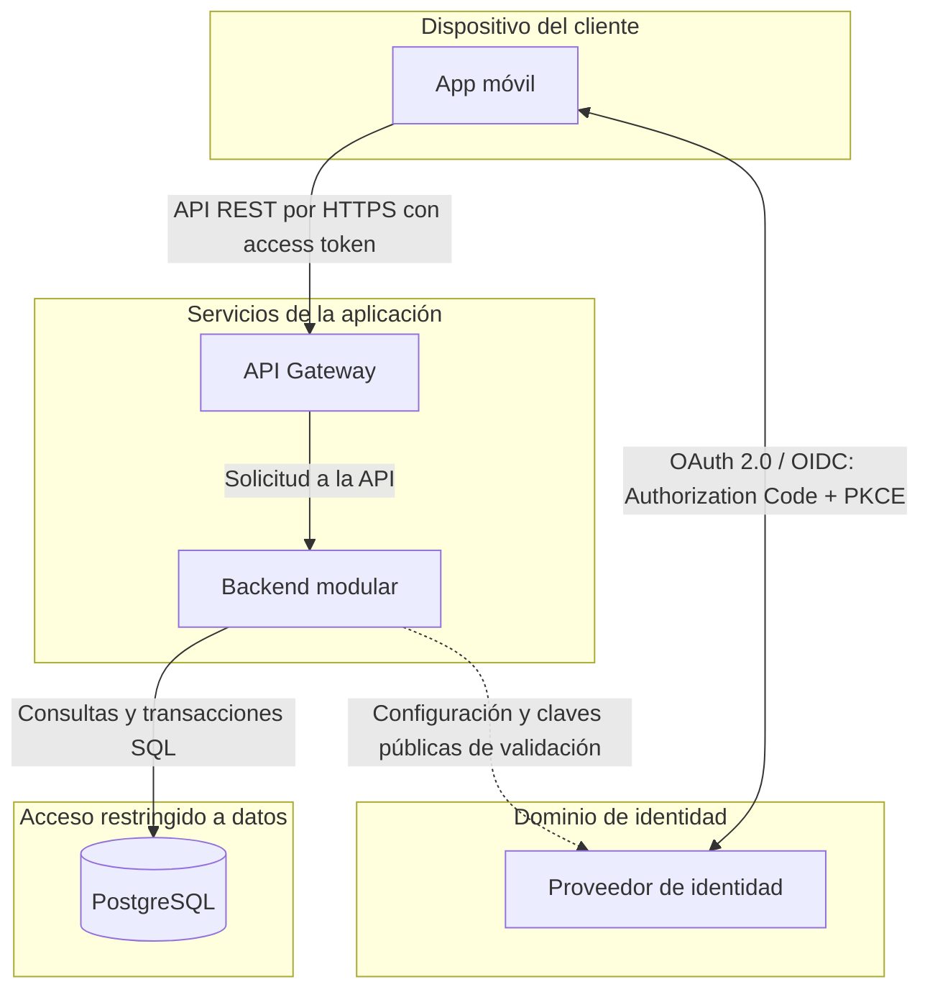

Propongo organizar la aplicación con un proveedor de identidad separado y un backend modular. El gateway concentra los controles generales de entrada; el backend valida el access token, los permisos sobre cada recurso y las reglas de negocio. PostgreSQL almacena los datos y permite agrupar las escrituras en transacciones.
Los módulos de usuarios, cuentas y movimientos forman parte de una misma aplicación backend. Los recuadros delimitan las zonas de confianza y ayudan a identificar dónde aplicar controles.
La línea punteada representa la obtención de configuración y claves públicas del proveedor de identidad. Esa dependencia no implica consultar al proveedor en cada petición.
Esta propuesta supone que PostgreSQL registra los movimientos de dinero. La integración con un core bancario externo queda pendiente de confirmar con el equipo.