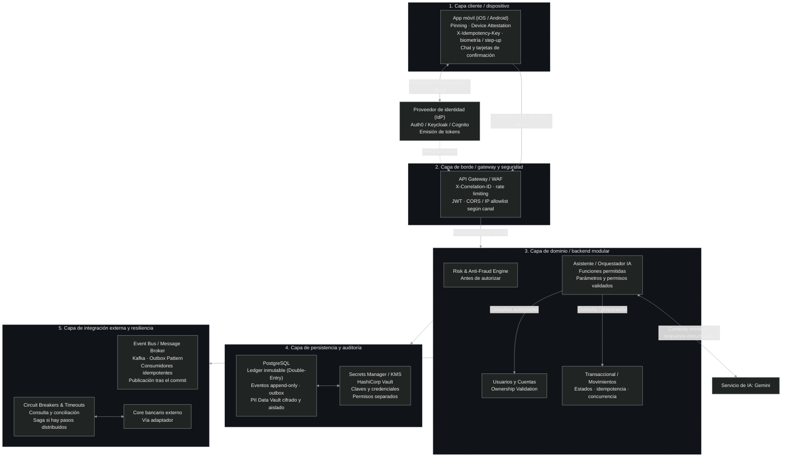

# 01 · Arquitectura de la aplicación bancaria

La propuesta organiza la app en cinco capas, con un proveedor de identidad separado. El backend concentra las reglas de negocio en una aplicación modular; el asistente utiliza Gemini a través de un orquestador dentro de ese backend.

**Estado:** diseño propuesto. La selección de IdP/Gateway, la configuración operativa y la verificación de controles siguen pendientes.

## 1. Vista general

[Abrir versión vectorial](diagrama-arquitectura-bancaria.svg).

El recorrido principal es **app → gateway → backend**. Desde el backend se accede a persistencia y a integraciones externas. Las flechas representan relaciones entre componentes; no todos participan en cada solicitud. Los recuadros agrupan responsabilidades, pero el aislamiento efectivo depende de identidades, permisos y controles de acceso.

| Capa | Responsabilidad |
|---|---|
| **1. Cliente / dispositivo** | App Android e iOS: login, consultas, chat y confirmación visible de operaciones. |
| **2. Gateway / seguridad** | El gateway es el punto de entrada; el WAF filtra tráfico HTTP. Se aplican validación de access tokens, límites y trazabilidad. |
| **3. Backend modular** | Autorizar cada recurso, evaluar riesgo y aplicar las reglas de cuentas, transferencias y asistente. |
| **4. Persistencia / auditoría** | Conservar el registro contable, los hechos de negocio y los datos protegidos. |
| **5. Integración / resiliencia** | Publicar eventos y comunicarse con el core, controlando fallos y resultados inciertos. |

## 2. Identidad, dispositivo y entrada

El **proveedor de identidad (IdP)** autentica y emite tokens mediante OAuth 2.0 / OIDC con Authorization Code + PKCE. Auth0, Keycloak y Cognito son opciones por evaluar. La app envía el access token a la API; los demás tokens y su almacenamiento se explican en [autenticación](03-autenticacion.md).

El gateway aplica controles generales; el backend valida el token y decide si el usuario puede operar sobre el recurso solicitado. La línea **JWKS en caché** representa las claves públicas usadas para validar firmas, con actualización para su rotación; no exige consultar al IdP en cada petición.

| Control del diagrama | Para qué sirve y qué falta concretar |
|---|---|
| HTTPS/TLS y certificate pinning | Proteger el canal y limitar los certificados o claves aceptados. El pinning necesita respaldo, rotación y recuperación: una renovación mal coordinada puede dejar la app sin conexión. Android lo desaconseja como opción general; su uso requiere una política operativa. |
| Device attestation | Play Integrity / App Attest aportan señales de integridad. El servidor verifica la evidencia y su vínculo con la solicitud; la identidad y los permisos se comprueban por separado. |
| Biometría / step-up | Verificación adicional para una operación sensible. El servidor debe comprobar evidencia vinculada al importe y destino; la biometría local por sí sola no acredita esa autorización. |
| `X-Idempotency-Key` | Identifica una misma intención en sus reintentos. La app conserva la clave y el backend la persiste y controla. |
| Trazabilidad y límites | `X-Correlation-ID` relaciona el recorrido; `X-Request-ID` identifica la solicitud. La infraestructura genera o valida estos valores y aplica rate limiting. |

CORS corresponde a clientes de navegador. Las listas de IP se aplican donde el canal lo permita; no se presupone una IP fija por teléfono.

## 3. Módulos del backend

| Módulo | Responsabilidad |
|---|---|
| **Usuarios y Cuentas** | Resolver al usuario local y validar estado, titularidad —ownership— y permisos por cuenta. |
| **Risk & Anti-Fraud Engine** | Evaluar riesgo antes de autorizar: permitir, rechazar o solicitar verificación adicional. |
| **Transaccional / Movimientos** | Coordinar estados, fondos, idempotencia y concurrencia, y contabilizar solo operaciones válidas. |
| **Asistente / Orquestador IA** | Gestionar conversaciones y validar las funciones que Gemini propone llamar. |

La decisión de riesgo debe corresponder a los datos finalmente ejecutados. Las evaluaciones externas ocurren antes de bloquear cuentas; dentro de la transacción SQL se revalidan fondos y reglas. Los estados registran avances y resultados; un timeout externo puede dejar una operación pendiente de confirmar.

### Asistente con Gemini

Gemini interpreta el mensaje; el orquestador valida sus propuestas contra funciones y parámetros permitidos. El catálogo inicial contiene:

- **`get_account_balance`:** consulta el saldo mediante Cuentas, con autorización del usuario.
- **`prepare_transfer`:** prepara una propuesta identificada y con vencimiento. Todavía no mueve dinero.

El usuario pide la operación, revisa la tarjeta y la confirma mediante una solicitud separada. El servidor recupera los datos canónicos de la propuesta y verifica propietario, vencimiento, confirmación, riesgo, step-up, fondos e idempotencia. Cambiar importe o destino exige una nueva propuesta y confirmación.

El modelo no recibe una función de ejecución ni acceso directo a PostgreSQL, Kafka, secretos o core. Los saldos y tarjetas provienen de los módulos bancarios. Se envía a Gemini solo el contexto admitido, sin tokens de usuario ni secretos. Ante un fallo se informa la indisponibilidad; las operaciones bancarias directas conservan su propio flujo. Ver [contrato del asistente](04-contratos-api.md#5-asistente) y [amenazas específicas](05-threat-model.md#asistente-y-secretos).

## 4. Persistencia, eventos e integraciones

| Concepto | Qué conserva o resuelve |
|---|---|
| **Ledger de partida doble** | Entradas balanceadas por operación y moneda. Los asientos confirmados se conservan; una corrección agrega una compensación. Permite reconstruir saldos si incluye aperturas y todas las contrapartidas. |
| **Eventos append-only** | Historial al que se agregan hechos, sin reescribir los anteriores, con identificador, tipo, versión y secuencia. Complementa el estado actual. Usar Event Sourcing como fuente de verdad sería otra decisión. |
| **Outbox transaccional** | Tabla de salida que guarda la intención de publicar junto con el cambio de negocio en la misma transacción SQL. Evita confirmar dinero y perder el evento por una caída entre ambas escrituras. |
| **Kafka** | Broker —intermediario de mensajes— que distribuye los eventos después del commit. Puede haber duplicados: los consumidores deben deduplicar por `event_id` junto con su efecto local. |
| **Saga, cuando aplique** | Coordina pasos distribuidos y compensaciones cuando una única transacción SQL no alcanza. Una compensación financiera registra una nueva operación. |

Outbox, Kafka y Saga cubren problemas distintos. Kafka utiliza un log append-only, pero su retención, compactación y administración pueden eliminar registros; no reemplaza el ledger ni su conservación.

La inmutabilidad requiere restringir escrituras, controlar accesos privilegiados y proteger auditoría y respaldos. El diseño detallado del ledger está en [modelo relacional](02-modelo-relacional.md).

### Datos personales y claves

El **PII Data Vault** almacena información personal identificable —PII— cifrada y con acceso restringido; el ledger conserva referencias y los datos mínimos. Su aislamiento físico y lógico sigue pendiente.

**HashiCorp Vault** gestiona secretos técnicos, incluida la credencial de Gemini. Para operaciones criptográficas se evalúa Transit: cifra o descifra, mientras el contenido cifrado se guarda fuera de Vault. Administrar claves, usarlas y leer datos personales requieren permisos separados. Faltan motores, identidades, rotación y recuperación; separar carpetas dentro de un proceso no garantiza ese aislamiento.

### Core y resultados inciertos

El adaptador del core utiliza **timeouts** para limitar la espera y **circuit breakers** para suspender llamadas ante fallos repetidos. Si vence un timeout, el core podría haber procesado el pedido: se consulta o concilia su estado antes de repetirlo o declararlo fallido.

Quedan por definir el contrato del core, sus identificadores e idempotencia, y cuál será la fuente oficial del dinero. También faltan el orden por entidad, retención y tratamiento de eventos que no pueden procesarse. Cualquier dato en caché debe indicar su antigüedad y respetar permisos.

## 5. Recorrido de una transferencia interna

Ejemplo entre cuentas distintas en ARS, sin comisiones, suponiendo que PostgreSQL registra ambos lados:

1. La app envía access token, datos confirmados y clave de idempotencia.
2. Gateway y backend validan acceso; los módulos comprueban permisos, evidencia de confirmación y riesgo.
3. El backend reconoce reintentos. Para una operación nueva, reclama la clave, bloquea cuentas y revalida fondos dentro de SQL.
4. Una misma transacción guarda operación, partida doble, evento e intención de publicación. Se responde éxito después del commit; un fallo técnico anterior revierte el conjunto.
5. El publicador lee la outbox y envía a Kafka; cada consumidor evita repetir su efecto.

Si se pierde la respuesta después del commit, la misma clave y contenido recuperan la operación existente. Una transacción SQL local no incluye automáticamente al core ni al Data Vault. Las garantías y restricciones se desarrollan en [02](02-modelo-relacional.md); el esquema de eventos/outbox aún debe completarse.

## 6. Decisiones que siguen abiertas

- Fuente oficial del dinero, confirmaciones externas y conciliación con el core.
- Política de riesgo, step-up, atestación y operación del pinning.
- Aislamiento del Data Vault, permisos y configuración de HashiCorp Vault.
- Modelo y límites de Gemini, datos admitidos y retención de conversaciones.
- Contratos de confirmación y esquemas pendientes de datos y eventos.

Las verificaciones y los riesgos pendientes se concentran en [STRIDE](05-threat-model.md).

## Para profundizar

- AWS: [Transactional Outbox](https://docs.aws.amazon.com/prescriptive-guidance/latest/cloud-design-patterns/transactional-outbox.html) y [Saga](https://docs.aws.amazon.com/prescriptive-guidance/latest/cloud-design-patterns/saga-orchestration.html).
- Apache Kafka: [retención y compactación](https://kafka.apache.org/43/configuration/topic-configs/).
- Android: [TLS y pinning](https://developer.android.com/privacy-and-security/security-ssl) y [Play Integrity](https://developer.android.com/google/play/integrity/standard). Apple: [App Attest](https://developer.apple.com/videos/play/wwdc2021/10244/).
- HashiCorp Vault: [Transit](https://developer.hashicorp.com/vault/docs/secrets/transit) y [políticas](https://developer.hashicorp.com/vault/docs/concepts/policies).
- Microsoft: [Circuit Breaker](https://learn.microsoft.com/en-us/azure/architecture/patterns/circuit-breaker). OWASP: [autorización de transacciones](https://cheatsheetseries.owasp.org/cheatsheets/Transaction_Authorization_Cheat_Sheet.html).

Diagrama en Mermaid

El PNG y el SVG conservan la composición del diagrama. La versión Mermaid contiene los mismos componentes con distribución automática.

