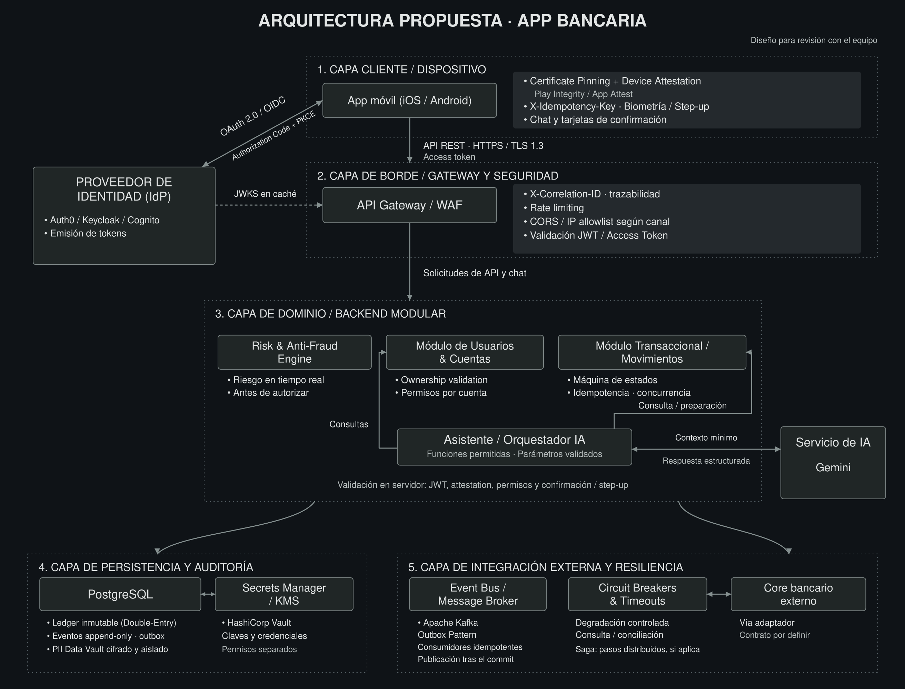
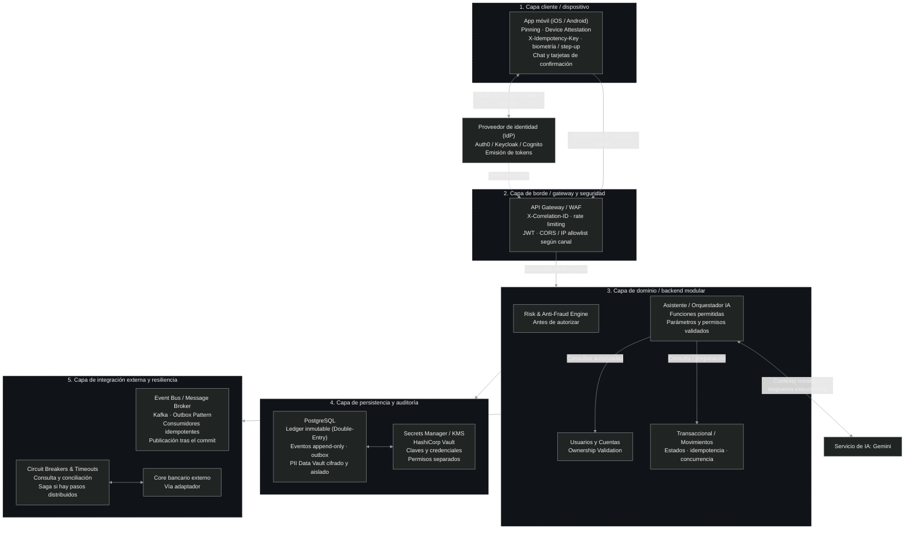

# 01 · Arquitectura propuesta para la app bancaria

**Estado:** propuesta de arquitectura actualizada al 14 de octubre de 2026. Gemini es el servicio de IA elegido para el asistente y HashiCorp Vault se incorpora para secretos y claves. La implementación y validación de los controles, la configuración operativa, la selección del IdP/Gateway y los contratos externos siguen pendientes.

Propongo una app para Android e iOS, un proveedor de identidad separado y un backend modular. El diseño separa la persistencia y protección de los datos de la integración con eventos y sistemas externos. El asistente se incorpora como un módulo del backend que utiliza Gemini y accede a las funciones bancarias permitidas.

## Vista general

[Versión vectorial del diagrama](diagrama-arquitectura-bancaria.svg).

El flujo principal sigue el recorrido **app → gateway → backend**. El proveedor de identidad está a la izquierda. Desde el backend se abren las dos ramas inferiores: **persistencia y auditoría**, e **integración externa y resiliencia**. El asistente aparece dentro del backend y Gemini fuera de ese límite, como servicio externo. Las notas junto a cada componente indican sus controles principales.

Las flechas muestran relaciones entre componentes o capas; el recorrido concreto depende de la operación. Los recuadros punteados agrupan responsabilidades. Los límites de confianza deben concretarse mediante identidades, permisos y controles de acceso. Los módulos del backend, incluido el orquestador del asistente, forman parte de una misma aplicación.

## Responsabilidades y controles

### Identidad y capa 1 · Cliente / dispositivo

- **Inicio de sesión:** OAuth 2.0 / OIDC con Authorization Code + PKCE. El proveedor emite los tokens; Auth0, Keycloak y Cognito son opciones pendientes de selección.
- **Tokens:** la app presenta el access token a la API. El refresh token permite renovar el acceso según la política del proveedor. El ID token comunica el resultado de la autenticación y no se utiliza como credencial de la API. El access token se mantiene en memoria y el refresh token se protege mediante el almacenamiento seguro definido para cada plataforma.
- **Canal seguro:** HTTPS/TLS y certificate pinning entre la app y el gateway. Deben definirse pins de respaldo, rotación y recuperación. Android desaconseja el pinning de forma general por el riesgo de interrumpir la conectividad ante cambios de certificados; su incorporación necesita una política operativa acordada.
- **Device attestation:** Google Play Integrity en Android y Apple App Attest en iOS. El servidor verifica las evidencias y su vínculo con la solicitud. Aportan señales de integridad de la app y del dispositivo; la identidad del usuario y sus permisos se comprueban por separado.
- **Idempotencia:** la app conserva `X-Idempotency-Key` al reintentar el mismo pedido. El backend persiste la clave, su alcance y contenido para evitar repetir el efecto.
- **Biometría / step-up:** una operación sensible puede requerir verificación adicional. El servidor debe verificar la evidencia y vincularla con la operación concreta.
- **Chat y confirmación:** la app presenta las respuestas del asistente y una tarjeta con los datos de la transferencia propuesta. El botón de confirmación inicia una solicitud separada al backend; un mensaje del chat no confirma el movimiento.

### Capa 2 · Borde / gateway y seguridad

El **API Gateway / WAF** recibe las solicitudes y concentra los controles de entrada: validación del access token, filtrado de tráfico y rate limiting. Asigna o valida el contexto de seguimiento, incluido `X-Correlation-ID`, para relacionar los registros de una solicitud.

La flecha **JWKS en caché** representa las claves públicas que permiten verificar las firmas de los tokens. Deben comprobarse firma, emisor, destinatario y vigencia, con una política de actualización de claves. El backend mantiene la validación del token y la autorización por recurso, aunque esa dependencia no se repita en el diagrama.

**CORS** aplica a clientes de navegador. Las listas de IP se utilizan en conexiones donde tengan sentido; no se presupone una IP fija para cada teléfono.

### Capa 3 · Dominio / backend modular

| Módulo | Responsabilidad |
| --- | --- |
| **Risk & Anti-Fraud Engine** | Evalúa la operación y las señales verificadas antes de autorizar el movimiento. Puede permitir continuar, rechazar o pedir verificación adicional según la política. |
| **Usuarios y Cuentas** | Comprueba el estado del usuario y su relación con cada cuenta —ownership—, además de los permisos necesarios para operar. |
| **Transaccional / Movimientos** | Coordina estados, idempotencia, fondos y concurrencia. Confirma la operación solo cuando se cumplen todas las reglas. |
| **Asistente / Orquestador IA** | Gestiona el chat, limita las funciones disponibles, valida sus parámetros y conserva el contexto del usuario autenticado. Consulta los módulos bancarios o prepara una propuesta para confirmación. |

La decisión de riesgo debe corresponder al monto, destino y contexto que finalmente se ejecutan. En el flujo interno propuesto, las llamadas externas de evaluación ocurren antes de tomar los bloqueos contables; dentro de la transacción se revalidan fondos y reglas.

La **máquina de estados** permite transiciones justificadas y conserva su historial. Un timeout externo puede dejar el resultado pendiente de confirmar. El estado actual puede cambiar; los asientos confirmados y los hechos históricos se conservan.

### Asistente y servicio de IA

Gemini interpreta la solicitud y puede proponer llamadas a funciones. El orquestador comprueba qué función se permite, sus argumentos y los permisos del usuario antes de utilizarla. Las reglas del servidor prevalecen sobre cualquier instrucción del chat o respuesta del modelo.

| Función inicial | Resultado permitido |
|---|---|
| `get_account_balance` | Consultar el saldo de una cuenta autorizada mediante el módulo de Cuentas. |
| `prepare_transfer` | Preparar datos de una transferencia y devolver una propuesta identificada, con vencimiento y confirmación pendiente. No contabiliza movimientos. |

El recorrido propuesto es el siguiente:

1. La app envía el mensaje por el gateway; el backend valida la sesión y el acceso a la conversación.
2. El orquestador entrega a Gemini el contexto mínimo necesario y recibe texto o una llamada estructurada.
3. Una función válida accede al caso de uso autorizado. El backend construye los datos de saldo o de la tarjeta a partir del resultado real; si falla la consulta, informa la indisponibilidad.
4. Para transferir, el usuario revisa la tarjeta y confirma por una solicitud separada. El backend verifica usuario, propuesta, vencimiento, destino e importe, y aplica permisos, riesgo, step-up cuando corresponda, idempotencia y controles contables.

El LLM no dispone de una función para ejecutar transferencias ni de acceso directo a PostgreSQL, Kafka, secretos o core. La confirmación debe quedar vinculada a los datos exactos que se ejecutan. El motor de riesgo conserva su función independiente del asistente.

La conexión con Gemini lleva solo los datos admitidos por la política de contexto. Tokens de usuario, credenciales y claves quedan fuera de los mensajes. El prototipo utiliza datos ficticios; el uso de información real requiere definir su tratamiento, retención y configuración del servicio. Si Gemini falla, el chat devuelve un error controlado y las funciones bancarias directas mantienen su propio flujo.

Los contratos propuestos y su diferencia con el prototipo están en [04-contratos-api.md](04-contratos-api.md), secciones 6 y 7. Las amenazas específicas se incorporan a [STRIDE](05-threat-model.md).

### Capa 4 · Persistencia y auditoría

- **Ledger inmutable (Double-Entry):** cada asiento debe balancear débitos y créditos por moneda. Los asientos confirmados se preservan; una corrección agrega una nueva operación vinculada. Reconstruir saldos requiere un ledger completo, incluyendo apertura y contrapartidas.
- **Eventos append-only:** agregan el historial de hechos de cada transacción, con identificadores, tipo, versión y secuencia. Guardar únicamente el estado final no permite reconstruir todo lo sucedido. Adoptar Event Sourcing como fuente de verdad sería una decisión adicional.
- **Outbox transaccional:** en el ejemplo interno, operación, asientos, evento e intención de publicación se guardan en la misma transacción SQL. Los metadatos de entrega pueden actualizarse sin alterar el hecho histórico.
- **PII Data Vault:** protege datos personales sensibles mediante cifrado, acceso restringido y auditoría. El registro contable utiliza referencias y el mínimo de datos necesario. El diagrama agrupa esta responsabilidad en la capa de persistencia. Queda pendiente definir su aislamiento físico y lógico.
- **Secrets Manager / KMS — HashiCorp Vault:** Vault es la herramienta incorporada a la propuesta para gestionar credenciales técnicas, incluida la credencial del servicio de IA. Para la función criptográfica puede utilizarse Transit, con políticas separadas para administrar claves y utilizarlas. Transit procesa cifrado y descifrado; el contenido cifrado se conserva en el almacén de datos. Quedan por definir autenticación de servicios, motores, rotación, recuperación y la eventual integración con un KMS externo. El PII Data Vault y HashiCorp Vault tienen responsabilidades diferentes.

La inmutabilidad del historial necesita controles de escritura, auditoría de accesos privilegiados, conservación de copias y restauración probada. Estas garantías dependen de los controles de almacenamiento y acceso, además del uso de registros append-only.

### Capa 5 · Integración externa y resiliencia

| Componente | Criterio de implementación |
| --- | --- |
| **Event Bus / Message Broker** | Apache Kafka es la opción elegida para la propuesta. Un publicador toma la outbox después del commit y distribuye sus eventos. |
| **Outbox y consumidores** | La publicación admite reintentos y puede producir duplicados. Cada consumidor persiste su deduplicación por `event_id` junto con el efecto local; un efecto externo necesita su propia estrategia idempotente. |
| **Circuit Breakers & Timeouts** | Son controles del adaptador que comunica con el core. El timeout limita la espera; el circuit breaker suspende llamadas al alcanzar la condición de fallos definida. |
| **Core bancario externo** | Se integra mediante un contrato y un adaptador. Deben acordarse identificadores, estados, idempotencia y consulta o conciliación de resultados inciertos. |
| **Saga, si aplica** | Coordina varios pasos en sistemas independientes mediante estados, reintentos y compensaciones. Una compensación financiera genera una nueva operación según las reglas del negocio. |

**Outbox y Kafka se complementan:** la outbox coordina el cambio SQL con la intención de publicar; Kafka distribuye eventos. El publicador y los consumidores están resumidos en las notas del broker para mantener el diagrama compacto.

Kafka utiliza un log append-only, pero la retención, la compactación y las operaciones administrativas pueden eliminar registros. No sustituye al ledger ni a la política de conservación del historial financiero. Deben definirse clave de particionado, orden por entidad, reintentos y tratamiento de mensajes que no pueden procesarse.

**Resultado incierto:** si el core no responde a tiempo, podría haber procesado el pedido. El resultado debe consultarse o conciliarse antes de repetir el movimiento o declararlo fallido. La degradación ofrece funciones limitadas y explícitas, conservando permisos e indicando la antigüedad de datos en caché.

## Flujo de una transferencia interna

El siguiente ejemplo utiliza cuentas ficticias, una misma moneda y operaciones sin comisiones:

1. La app envía la solicitud, el access token y la clave de idempotencia.
2. Gateway y backend validan acceso y permisos. Se comprueban las evidencias requeridas y se evalúa el riesgo antes de autorizar.
3. El backend reconoce los reintentos del mismo pedido. Para una operación nueva, controla concurrencia e idempotencia dentro de la transacción, bloquea lo necesario y revalida fondos y reglas.
4. Una sola transacción SQL registra la operación, la partida doble, el evento y la outbox. Se responde con éxito después del commit; un fallo previo revierte el conjunto.
5. El publicador envía el evento confirmado a Kafka. Los consumidores procesan sus efectos sin duplicarlos.

Si la respuesta al cliente se pierde, reintentar con la misma clave y contenido recupera la operación existente. Reutilizar la clave con otro contenido se rechaza. La unicidad debe resolver también solicitudes concurrentes, verificando permisos en cada intento.

Este ejemplo supone que PostgreSQL registra ambos lados de la transferencia interna. **Queda pendiente definir qué sistema será el registro oficial de los movimientos cuando intervenga el core.** Una transacción SQL local no abarca automáticamente al core ni al Data Vault. Saga solo se incorpora cuando exista un flujo distribuido que la necesite.

## Controles transversales y definiciones pendientes

Las trazas, logs, métricas y alertas permiten seguir solicitudes, fallos y eventos pendientes. La auditoría conserva los hechos relevantes. Los registros técnicos evitan contraseñas, tokens y datos personales sensibles.

El modelo de amenazas **STRIDE** acompaña el diseño: suplantación, manipulación, repudio, exposición de información, denegación de servicio y elevación de privilegios. Cada control necesita un escenario y una verificación en `05-threat-model.md`.

Quedan pendientes las siguientes definiciones:

1. **Ledger y core:** fuente oficial del dinero, estados, evidencia de confirmación y conciliación.
2. **Riesgo y autenticación adicional:** reglas, vigencia y comportamiento ante indisponibilidad o dispositivos sin soporte.
3. **Datos y secretos:** aislamiento del Data Vault, configuración de HashiCorp Vault, permisos de descifrado y operación del pinning.
4. **Eventos y operaciones distribuidas:** retención, orden, reintentos, límites de acumulación y alcance de Saga.
5. **Asistente:** versión de modelo habilitada en Gemini, límites y timeouts, contexto admitido, conservación de conversaciones y contrato final de preparación/confirmación.

## Referencias

- [AWS: Transactional Outbox](https://docs.aws.amazon.com/prescriptive-guidance/latest/cloud-design-patterns/transactional-outbox.html), [Saga](https://docs.aws.amazon.com/prescriptive-guidance/latest/cloud-design-patterns/saga-orchestration.html) y [reintentos idempotentes](https://aws.amazon.com/builders-library/making-retries-safe-with-idempotent-APIs/).
- [Apache Kafka: diseño](https://kafka.apache.org/42/design/design/) y [retención y compactación](https://kafka.apache.org/43/configuration/topic-configs/).
- [OWASP: autorización de transacciones](https://cheatsheetseries.owasp.org/cheatsheets/Transaction_Authorization_Cheat_Sheet.html) y [seguridad REST](https://cheatsheetseries.owasp.org/cheatsheets/REST_Security_Cheat_Sheet.html).
- [Android: Play Integrity](https://developer.android.com/google/play/integrity/standard) y [seguridad de red y pinning](https://developer.android.com/privacy-and-security/security-ssl).
- [Apple: App Attest](https://developer.apple.com/videos/play/wwdc2021/10244/) y [AWS: conceptos de KMS](https://docs.aws.amazon.com/kms/latest/developerguide/concepts.html).
- [Microsoft: Circuit Breaker](https://learn.microsoft.com/en-us/azure/architecture/patterns/circuit-breaker) y [OpenTelemetry: contexto de trazas](https://opentelemetry.io/docs/concepts/context-propagation/).

- [Google: SDK de Gemini](https://ai.google.dev/gemini-api/docs/libraries).
- [HashiCorp Vault: KV](https://developer.hashicorp.com/vault/docs/secrets/kv), [Transit](https://developer.hashicorp.com/vault/docs/secrets/transit) y [políticas](https://developer.hashicorp.com/vault/docs/concepts/policies).
- [OWASP: prevención de prompt injection](https://cheatsheetseries.owasp.org/cheatsheets/LLM_Prompt_Injection_Prevention_Cheat_Sheet.html) y [privilegios excesivos en asistentes](https://genai.owasp.org/llmrisk/llm062025-excessive-agency/).

Diagrama en Mermaid

El PNG y el SVG conservan la composición del diagrama. La versión Mermaid contiene los mismos componentes con distribución automática.

