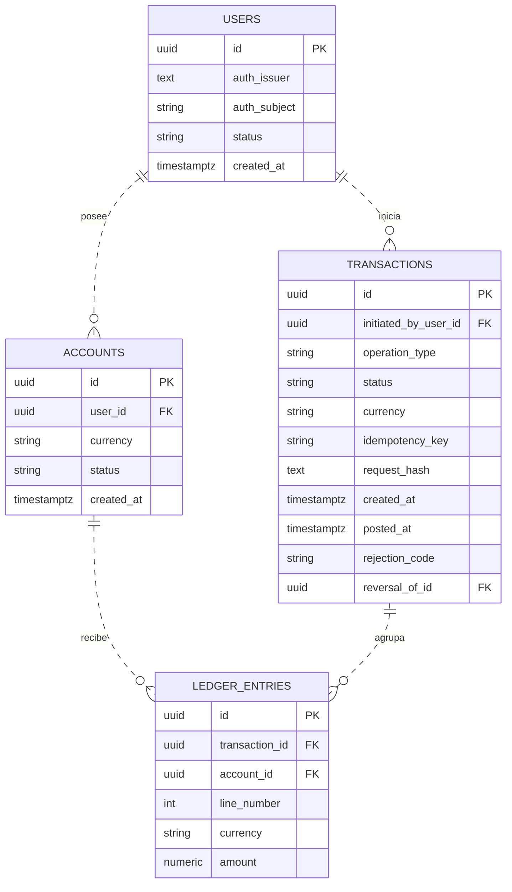
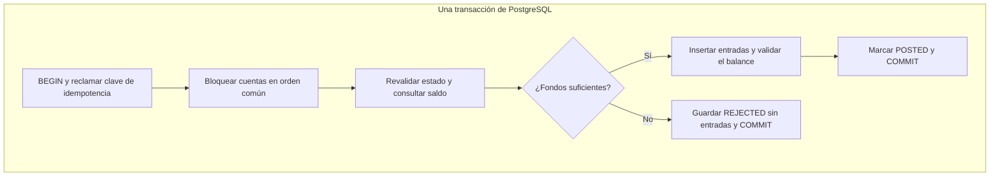

# 02 · Modelo lógico de transferencias

El modelo propone un **ledger de partida doble en PostgreSQL**. Es el registro contable de la aplicación: cada operación confirmada agrupa entradas balanceadas y conserva su historial.

**Alcance:** transferencias internas en ARS entre cuentas de clientes distintas y activas, sin comisiones, retenciones ni descubierto. Se supone que PostgreSQL registra ambos lados; la relación con un core externo sigue pendiente. El esquema y sus garantías requieren implementación y pruebas.

## 1. Entidades y claves

| Entidad | Qué representa |
|---|---|
| `users` | Usuario local vinculado a la identidad del proveedor. |
| `accounts` | Cuenta del cliente, titular, moneda y estado. |
| `transactions` | Operación de negocio, resultado e información de idempotencia. |
| `ledger_entries` | Débitos y créditos que componen la operación. |

**Leyenda:** `PK` identifica una fila; `FK` referencia otra tabla. `||` significa uno y `o{`, cero o muchos. La línea discontinua indica una relación no identificadora: la FK no forma parte de la PK. Una operación rechazada tiene cero entradas; una confirmada debe cumplir las reglas contables siguientes.

**Tipos propuestos:** UUID para identificadores, `TIMESTAMPTZ` para fechas, `NUMERIC(20,2)` para importes, `VARCHAR(3)` para moneda, `VARCHAR(255)` para `auth_subject` y `VARCHAR(128)` para la clave de idempotencia. `string` representa texto en el diagrama. Solo `posted_at`, `rejection_code` y `reversal_of_id` son opcionales; este último referencia `transactions.id`.

## 2. Partida doble y saldo

Por operación y moneda, **débitos = créditos**. Para esta transferencia simple se exigen dos entradas en las cuentas autorizadas, por el mismo importe y con signos opuestos.

Las cuentas de clientes se representan desde la perspectiva de la entidad: son pasivos porque contienen dinero que esta debe al cliente. En este modelo el signo negativo codifica un débito que reduce ese saldo; el positivo, un crédito que lo aumenta.

**Ejemplo: T1 transfiere ARS 10.000 de A a B.**

| Operación | Línea | Cuenta | `amount` | Efecto |
|---|---:|---|---:|---|
| T1 | 1 | A | −10.000,00 | Débito al origen. |
| T1 | 2 | B | +10.000,00 | Crédito al destino. |

T1, A y B abrevian UUID. Ambas entradas son en ARS y suman cero. El saldo de cada cuenta se obtiene sumando sus entradas de operaciones `POSTED`, incluida la apertura; `accounts` no guarda otro saldo.

**Límite actual:** faltan cuentas internas y contrapartidas de apertura, necesarias para representar fondos iniciales, depósitos y retiros. El `user_id` obligatorio solo cubre cuentas de clientes. Otras naturalezas contables requieren adaptar el cálculo: un débito aumenta una cuenta de activo, por ejemplo.

## 3. Atomicidad: confirmar todo junto

Antes de contabilizar, se valida usuario activo, permiso para debitar el origen, cuentas distintas y activas, moneda e importe. El destino puede pertenecer a otra persona. Confirmación, riesgo y step-up deben corresponder a los mismos datos; las llamadas externas se realizan antes de tomar bloqueos contables.

La fila de `transactions` representa el negocio; la **transacción SQL** hace que sus escrituras se confirmen juntas. Un fallo técnico antes del commit revierte el intento, incluida la clave reclamada. Si se pierde la respuesta después del commit, el movimiento ya existe y se recupera con la misma clave.

| Estado del flujo interno | Significado |
|---|---|
| `PENDING` | Preparación transitoria dentro de SQL. |
| `POSTED` | Operación confirmada con entradas completas. |
| `REJECTED` | Rechazo de negocio persistido, sin entradas. |

La arquitectura también exige guardar evento e intención de publicación en esa misma transacción. **Sus tablas de eventos/outbox aún no están definidas en este esquema de cuatro entidades.** Los estados externos requieren un diseño adicional; un timeout del core no equivale a `REJECTED`.

## 4. Idempotencia y concurrencia

Son garantías distintas: la idempotencia evita repetir una misma operación; la concurrencia controla operaciones diferentes que compiten por los mismos fondos.

### Una intención, una clave

La app conserva `X-Idempotency-Key` al reintentar. El servidor obtiene al usuario del token y calcula `request_hash` con tipo, origen, destino, moneda e importe normalizados.

| Situación | Resultado |
|---|---|
| Clave nueva | Procesar la operación. |
| Misma clave y mismo hash | Recuperar el resultado registrado, sin nuevas entradas. |
| Misma clave y distinto hash | Rechazar por conflicto. |

`UNIQUE(initiated_by_user_id, idempotency_key)` resuelve solicitudes simultáneas. La reclamación debe gestionar ese conflicto atómicamente; consultar primero e insertar después no basta. Si otro intento sigue en curso, se necesita una espera acotada y una política de reintento. Los permisos se verifican en cada petición.

### Dos operaciones sobre el mismo saldo

Se propone `READ COMMITTED` y bloquear las cuentas involucradas en un orden común. Después de obtener los bloqueos, **una nueva sentencia** revalida estados y consulta saldo; los bloqueos duran hasta finalizar SQL.

Por ejemplo, dos transferencias de ARS 80.000 no pueden aprobarse ambas contra un saldo de ARS 100.000. La segunda debe evaluar el saldo que dejó la primera. Todos los procesos que contabilicen deben seguir el protocolo: bloquear `accounts` no impide por sí solo que otro proceso inserte entradas fuera de él.

## 5. Restricciones que debe aplicar la implementación

| Regla | Mecanismo propuesto |
|---|---|
| Identidad única | `UNIQUE(auth_issuer, auth_subject)`, correspondientes a `(iss, sub)` validados. |
| Idempotencia | Clave única por usuario y comparación del hash calculado por el servidor. |
| Líneas identificables | `UNIQUE(transaction_id, line_number)` y número positivo. |
| Moneda coherente | FK compuestas `(account_id, currency)` y `(transaction_id, currency)`; sus destinos requieren `UNIQUE(id, currency)`. |
| Importes válidos | Decimales exactos, finitos, no nulos ni cero; solicitud positiva y escala validada antes de guardar. |
| Balance contable | Suma cero por operación y moneda; dos entradas con cuentas e importe autorizados para este caso. |
| Valores permitidos | Usuarios: ACTIVE/BLOCKED. Cuentas: ACTIVE/BLOCKED/CLOSED. Operaciones: PENDING/POSTED/REJECTED. Tipos: TRANSFER/REVERSAL. |
| Historial conservado | Impedir editar o borrar operaciones `POSTED` y sus entradas. |
| Reversión | Máximo una reversión completa confirmada por original; autorización e índice condicional por concretar. |
| Escrituras controladas | Consultas parametrizadas y rol sin privilegios administrativos; acceso financiero limitado al circuito de contabilización. |

Un `CHECK` ordinario no valida el balance entre varias filas. Hace falta una rutina de contabilización, validación diferida en la base o ambas. Una operación balanceada también necesita autorización y fondos suficientes.

## 6. Historial, propuestas y recuperación

**Correcciones:** registrar una nueva operación compensatoria con `reversal_of_id`. La original sigue `POSTED`; el saldo incluye ambas. Reconstruir significa recalcular desde un historial completo y un corte consistente, sin ejecutar de nuevo las transferencias. `posted_at` por sí solo no garantiza el orden de commit; faltan fechas efectivas y criterio de corte.

**Auditoría:** conservar actor, acción, recurso, fecha, resultado, solicitud y operación. Las confirmaciones deben coincidir con el commit; los intentos fallidos requieren un registro que sobreviva al rollback sin presentarlos como movimientos confirmados. Restringir accesos privilegiados y excluir tokens y datos sensibles innecesarios.

**Recuperación:** proteger respaldos, definir archivado WAL cuando corresponda y probar restauración con objetivos de pérdida de datos y tiempo de recuperación. El WAL no sustituye la auditoría de negocio. Si participa un core, conciliar identificadores y resultados: restaurar la base local no prueba qué ejecutó el sistema externo.

### Propuestas del asistente

Preparar una transferencia no crea entradas. La propuesta debe conservar identificador, propietario, origen, destino, moneda, importe, vencimiento y estado. Al confirmar, el servidor recupera esos datos y verifica pertenencia y vigencia.

**Una propuesta solo puede producir una operación efectiva**, incluso con confirmaciones simultáneas y claves de idempotencia distintas. En el flujo local, su vínculo a la operación y el cambio de estado se confirman junto con los asientos. Cambiar importe o destino exige otra propuesta y confirmación.

Conversaciones y propuestas requieren tablas y retención propias, pendientes de diseño; no forman parte del saldo. El PII Data Vault conserva datos personales separados del ledger y HashiCorp Vault gestiona secretos y claves, como explica [arquitectura](01-arquitectura.md#4-persistencia-eventos-e-integraciones).

## 7. Pendientes y verificación

Antes de implementar deben cerrarse: autoridad del ledger frente al core; cuentas internas y apertura; mecanismos de contabilización e inmutabilidad; reversiones; esperas y retención de claves; esquemas de eventos/outbox y propuestas; auditoría, cortes y recuperación.

Las pruebas deben demostrar ausencia de escrituras parciales, duplicados y sobregiros concurrentes, además de reconstrucción correcta y rechazo de propuestas inválidas. Los escenarios y evidencias están en [STRIDE](05-threat-model.md), especialmente TM-04–TM-08, TM-12, TM-13 y TM-18. Siguen pendientes de ejecución.

## Para profundizar

- [TigerBeetle: débitos, créditos y naturaleza de las cuentas](https://docs.tigerbeetle.com/coding/financial-accounting/).
- PostgreSQL: [transacciones](https://www.postgresql.org/docs/current/tutorial-transactions.html), [restricciones](https://www.postgresql.org/docs/current/ddl-constraints.html), [bloqueos](https://www.postgresql.org/docs/current/explicit-locking.html) y [aislamiento](https://www.postgresql.org/docs/current/transaction-iso.html).
- [Mermaid: notación de entidades y relaciones](https://mermaid.js.org/syntax/entityRelationshipDiagram.html).
