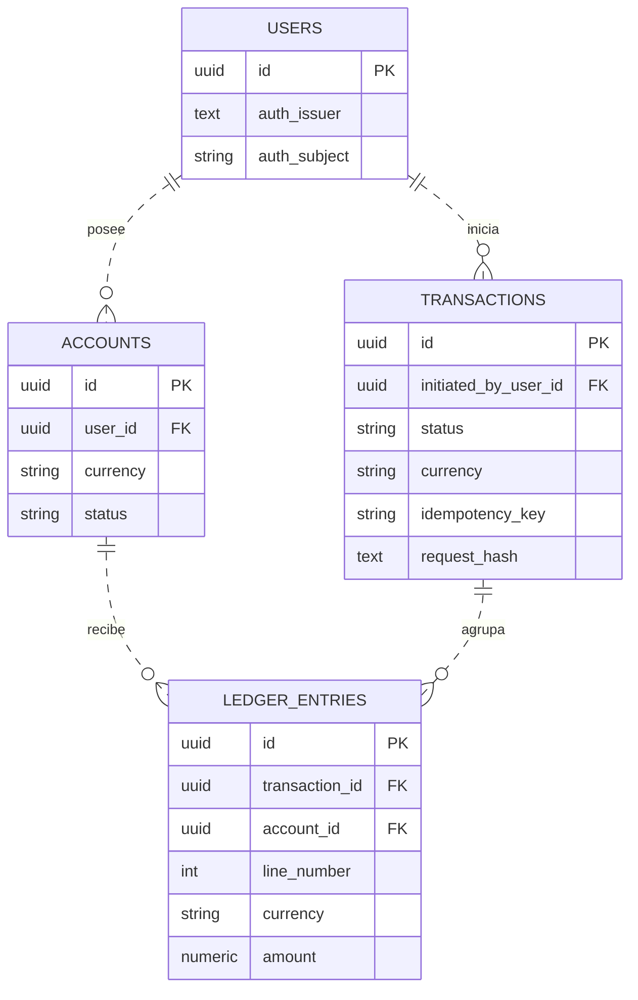
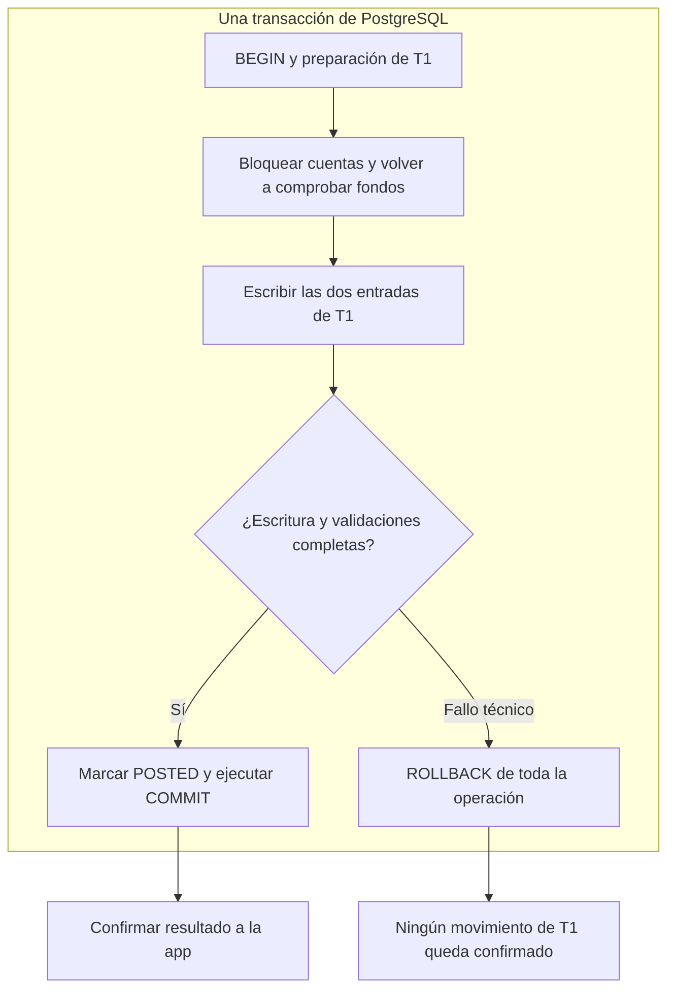
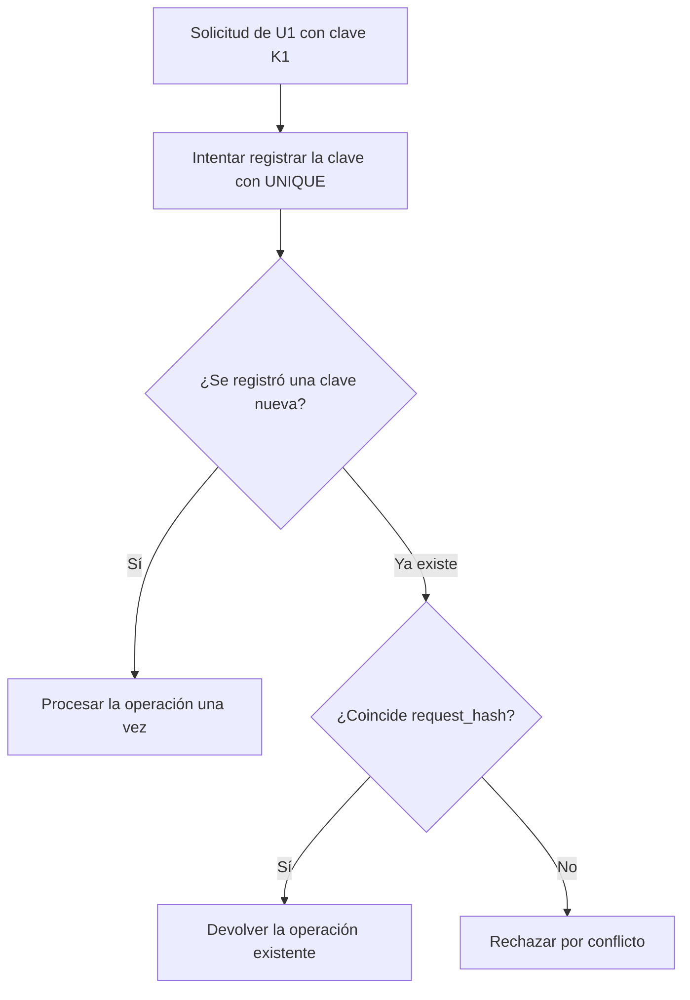

# Propuesta de modelo relacional

Armé esta propuesta como base para revisar con Diego y el equipo. Separé la operación de sus movimientos para definir cómo registrar una transferencia, confirmarla completa y resolver los reintentos sin duplicarla.

**Estado:** diseño inicial, pendiente de implementación y pruebas.

**Alcance:** transferencias internas entre dos cuentas distintas y activas, en ARS, sin comisiones, retenciones ni descubierto.

**Supuesto principal:** nuestra PostgreSQL registra los movimientos de dinero de forma autoritativa. Si las operaciones las ejecuta un core bancario externo, tenemos que revisar los estados, la confirmación y la conciliación: una transacción local no cubre los cambios de ese otro sistema.

## Entidades y relaciones

Propongo cuatro entidades: `users`, `accounts`, `transactions` y `ledger_entries`. El diagrama muestra sus campos principales; el listado completo de campos y restricciones está al final del documento.



### Notación

Los extremos de cada relación indican su cardinalidad:

| Símbolo a la derecha | Lectura |
|---|---|
| `\|\|` | Exactamente uno. |
| `o\|` | Cero o uno. |
| `o{` | Cero o muchos. |
| `\|{` | Uno o muchos. |

Por ejemplo, un usuario puede tener cero o muchas cuentas y cada cuenta pertenece a un usuario. `PK` identifica la clave primaria y `FK` una clave foránea. Las líneas discontinuas (`..`) representan relaciones no identificadoras: cada tabla tiene su propio `id` y las FK mostradas no forman parte de esa PK. La línea discontinua no vuelve opcional la referencia.

### Responsabilidad de cada entidad

| Entidad | Responsabilidad |
|---|---|
| `users` | Identifica al usuario dentro de nuestra aplicación. |
| `accounts` | Identifica la cuenta, su titular, moneda y estado. |
| `transactions` | Registra la operación completa, quién la inició, su resultado y los datos de idempotencia. |
| `ledger_entries` | Registra cuánto afecta esa operación a cada cuenta. |

Incluí `ledger_entries` para registrar por separado el efecto de una operación sobre cada cuenta. Una transferencia genera una entrada negativa en el origen y una positiva en el destino, ambas vinculadas a la misma operación.

El iniciador debe estar autorizado a debitar la cuenta origen; la cuenta destino puede pertenecer a otro usuario. Las FK protegen las relaciones, pero la autorización corresponde al backend.

El modelo permite cuentas sin movimientos y operaciones rechazadas sin entradas. Una operación confirmada debe tener al menos dos entradas balanceadas; para la transferencia simple de este alcance se exigen exactamente dos.

### Ejemplo de transferencia

Operación T1: transferir **ARS 10.000** de A a B.

| `transaction_id` | `line_number` | `account_id` | `currency` | `amount` |
|---|---:|---|---|---:|
| T1 | 1 | A | ARS | −10.000,00 |
| T1 | 2 | B | ARS | +10.000,00 |

T1, A y B son identificadores abreviados; en el modelo son UUID. Propongo `NUMERIC(20,2)` para los importes en ARS, con validación de escala antes de guardar. La precisión deberá revisarse si incorporamos otras monedas.

En esta versión, el saldo contable se obtiene sumando las entradas de la cuenta asociadas a operaciones `POSTED`. `accounts` no tiene un campo de saldo almacenado.

## Atomicidad

Propongo guardar la operación y sus entradas dentro de una única transacción de PostgreSQL. Para una solicitud nueva, la preparación de T1 incluye reclamar la clave de idempotencia dentro de esa misma transacción SQL. La solicitud debe estar autenticada y autorizada antes de contabilizarse.

El siguiente diagrama resume la confirmación y los fallos técnicos anteriores al commit:



Si ocurre un fallo técnico antes del commit, se revierten todas las escrituras de ese intento, incluida la operación y la clave reclamada. Esto también aplica si el fallo ocurre antes de la comprobación mostrada en el diagrama.

Un rechazo de negocio, como fondos insuficientes, se puede confirmar como `REJECTED` sin entradas. Así queda registrado el resultado y un reintento con la misma clave puede recuperarlo.

| Resultado | Cuenta A | Cuenta B |
|---|---:|---:|
| Antes del intento | 100.000,00 | 20.000,00 |
| T1 confirmada | 90.000,00 | 30.000,00 |
| T1 deshecha por fallo técnico | 100.000,00 | 20.000,00 |

La fila de `transactions` representa la operación de negocio; la transacción SQL agrupa sus escrituras. La confirmación debe evitar que quede un débito registrado sin su crédito.

Si el commit se completó y se perdió la respuesta, la operación sigue confirmada. Ante ese resultado incierto, el cliente debe reintentar con la misma clave.

## Idempotencia

La app asigna una clave a una intención de transferencia y conserva esa clave cuando reintenta. El backend obtiene el usuario de la identidad autenticada y calcula un hash del contenido normalizado.



Propongo resolver la unicidad en la base mediante:

```sql
UNIQUE (initiated_by_user_id, idempotency_key)
```

La clave se reclama al intentar registrar la operación, con una escritura atómica protegida por la restricción. Consultar primero si existe y luego insertar no alcanza para evitar carreras entre peticiones.

Si otra petición con esa clave sigue ejecutándose, necesitamos una política de espera y reintento con tiempos acotados. El cliente debe conservar la clave original hasta resolver el resultado.

| Petición | Resultado esperado |
|---|---|
| U1, K1, A a B, ARS 10.000 por primera vez | Crear y procesar T1. |
| U1, K1, A a B, ARS 10.000 otra vez | Devolver T1 sin nuevos movimientos. |
| U1, K1, A a B, ARS 15.000 | Rechazar el cambio de contenido. |

El backend calcula `request_hash` a partir del tipo de operación, origen, destino, moneda e importe normalizados. Si la clave ya existe, se compara el hash: con el mismo contenido se devuelve la operación existente; con contenido distinto se rechaza por conflicto. No se confía en un hash enviado por el cliente.

La clave no reemplaza la autenticación ni la autorización. Su política de conservación debe cubrir el período de reintentos admitido.

## Concurrencia

La idempotencia cubre reintentos de una misma intención. Dos transferencias distintas usan claves diferentes y pueden competir por el mismo saldo.

Para esta versión propongo `READ COMMITTED` con bloqueo de las cuentas involucradas en un orden común. Después de adquirir los bloqueos, se vuelve a consultar el saldo en una sentencia nueva. La comprobación de fondos y las escrituras se mantienen dentro de la misma transacción SQL.

**Ejemplo:** A tiene 100.000 y llegan solicitudes por 80.000 y 70.000. Si la primera confirma 80.000, la segunda encuentra 20.000 al conseguir el bloqueo y rechaza los 70.000.

Todos los caminos que escriban movimientos deben respetar ese protocolo. Bloquear la fila de una cuenta no impide por sí solo que otro proceso inserte entradas directamente; por eso hay que restringir las escrituras que eludan la contabilización. Los tiempos máximos de espera y los reintentos por abortos quedan por definir e implementar.

## Campos y restricciones

### Campos del modelo propuesto

| Entidad | Campos |
|---|---|
| `users` | `id UUID PK`, `auth_issuer TEXT`, `auth_subject VARCHAR(255)`, `status`, `created_at TIMESTAMPTZ`. |
| `accounts` | `id UUID PK`, `user_id UUID FK`, `currency VARCHAR(3)`, `status`, `created_at TIMESTAMPTZ`. |
| `transactions` | `id UUID PK`, `initiated_by_user_id UUID FK`, `operation_type`, `status`, `currency VARCHAR(3)`, `idempotency_key VARCHAR(128)`, `request_hash TEXT`, `created_at TIMESTAMPTZ`, `posted_at TIMESTAMPTZ`, `rejection_code`, `reversal_of_id UUID FK`. |
| `ledger_entries` | `id UUID PK`, `transaction_id UUID`, `account_id UUID`, `line_number INTEGER`, `currency VARCHAR(3)`, `amount NUMERIC(20,2)`. |

Los campos son obligatorios salvo los condicionales: `posted_at` corresponde a operaciones `POSTED`, `rejection_code` a operaciones `REJECTED` y `reversal_of_id` a reversiones. Los tipos y restricciones de los estados y códigos se concretarán al implementar el esquema. `string` en el diagrama representa texto; los tipos SQL propuestos se detallan en esta tabla.

### Restricciones y responsabilidades

| Regla | Mecanismo propuesto |
|---|---|
| Una identidad externa por usuario local | `UNIQUE(auth_issuer, auth_subject)`. |
| Una clave de idempotencia por usuario | `UNIQUE(initiated_by_user_id, idempotency_key)` y comparación de `request_hash`. |
| Una numeración de entradas por operación | `UNIQUE(transaction_id, line_number)`, con número de línea positivo. |
| Cuenta y operación con la moneda de cada entrada | FK compuestas `(account_id, currency)` y `(transaction_id, currency)`, con `UNIQUE(id, currency)` en las tablas referenciadas. |
| Importes válidos | Decimales exactos, finitos y distintos de cero en las entradas. Importe positivo en la solicitud y escala validada antes de guardar. |
| Confirmación balanceada | Al menos dos entradas cuya suma sea cero por operación y moneda. En la transferencia simple se exigen exactamente dos, por el importe autorizado. |
| Estados coherentes | Usuarios ACTIVE/BLOCKED. Cuentas ACTIVE/BLOCKED/CLOSED. Operaciones PENDING/POSTED/REJECTED. Tipos TRANSFER/REVERSAL. |
| Historial conservado | Impedir cambios o borrados de operaciones confirmadas y sus movimientos. Corregir mediante operaciones compensatorias autorizadas. |
| Reversión completa única | Como máximo una reversión completa confirmada por original, con validaciones e índice condicional a concretar. |

La suma de varias filas no se puede imponer con un `CHECK` ordinario. Queda por concretar el mecanismo que valide estas reglas al confirmar, junto con la restricción de escrituras. Además del balance en cero, se deben validar las cuentas y el importe autorizados.

En esta propuesta, `PENDING` es transitorio dentro de la transacción SQL. El procesamiento asíncrono de operaciones pendientes queda fuera del alcance actual.

## Verificaciones previstas

| Caso | Evidencia esperada |
|---|---|
| Fallo entre la primera y la segunda entrada | No queda un débito confirmado aislado. |
| Reintentos simultáneos con la misma clave y contenido | Una sola operación efectiva. |
| Clave reutilizada con otro importe | Conflicto y ningún movimiento adicional. |
| Respuesta perdida después del commit | El reintento recupera la operación ya confirmada. |
| Dos operaciones distintas compitiendo por saldo | No confirman ambas si los fondos no alcanzan. |

Estas pruebas están previstas; todavía no se ejecutaron.

## Puntos para revisar con el equipo

- Confirmar si nuestra base registra los movimientos de dinero o si debemos integrarnos con un core externo.
- Validar el alcance inicial: monedas, comisiones, retenciones y política de descubierto.
- Definir cómo se impondrán el balance de las entradas y la inmutabilidad de las operaciones confirmadas.
- Acordar tiempos de bloqueo, reintentos y conservación de claves de idempotencia.
- Concretar la autorización y las restricciones de las reversiones completas.

## Referencias

- [Mermaid: entidades y relaciones](https://mermaid.js.org/syntax/entityRelationshipDiagram.html).
- [PostgreSQL: transacciones](https://www.postgresql.org/docs/current/tutorial-transactions.html).
- [PostgreSQL: restricciones](https://www.postgresql.org/docs/current/ddl-constraints.html).
- [PostgreSQL: INSERT y ON CONFLICT](https://www.postgresql.org/docs/current/sql-insert.html).
- [PostgreSQL: bloqueos explícitos](https://www.postgresql.org/docs/current/explicit-locking.html).
- [PostgreSQL: aislamiento de transacciones](https://www.postgresql.org/docs/current/transaction-iso.html).
