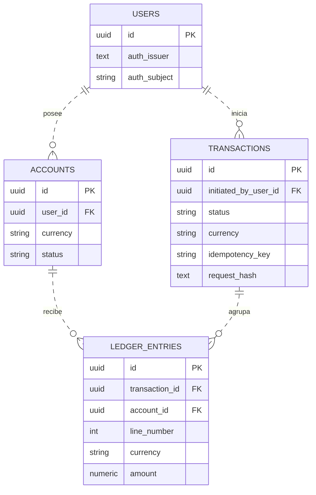
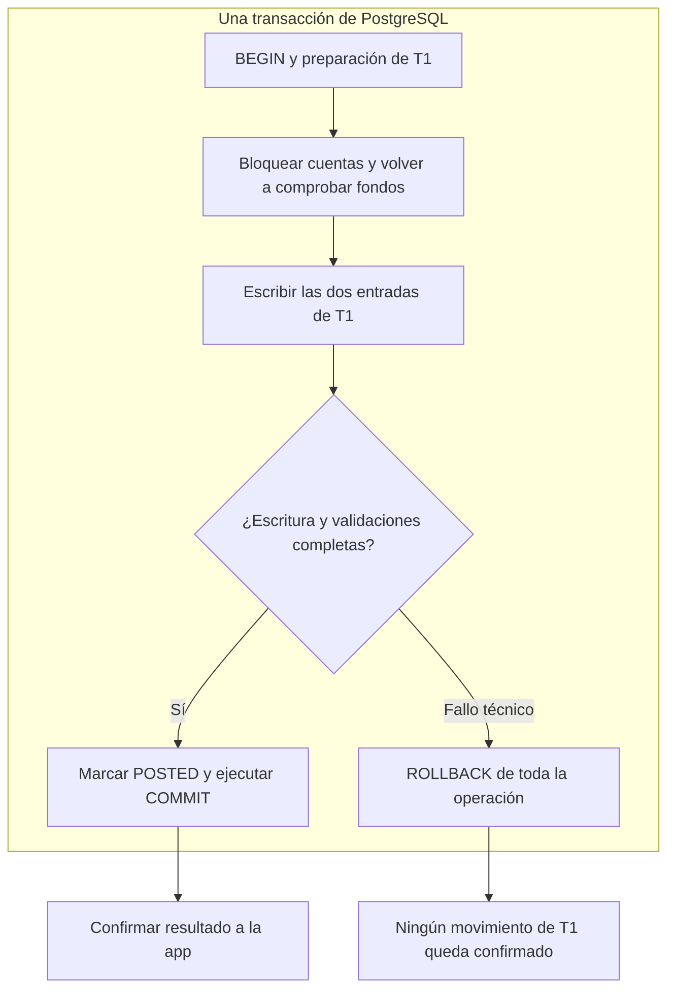
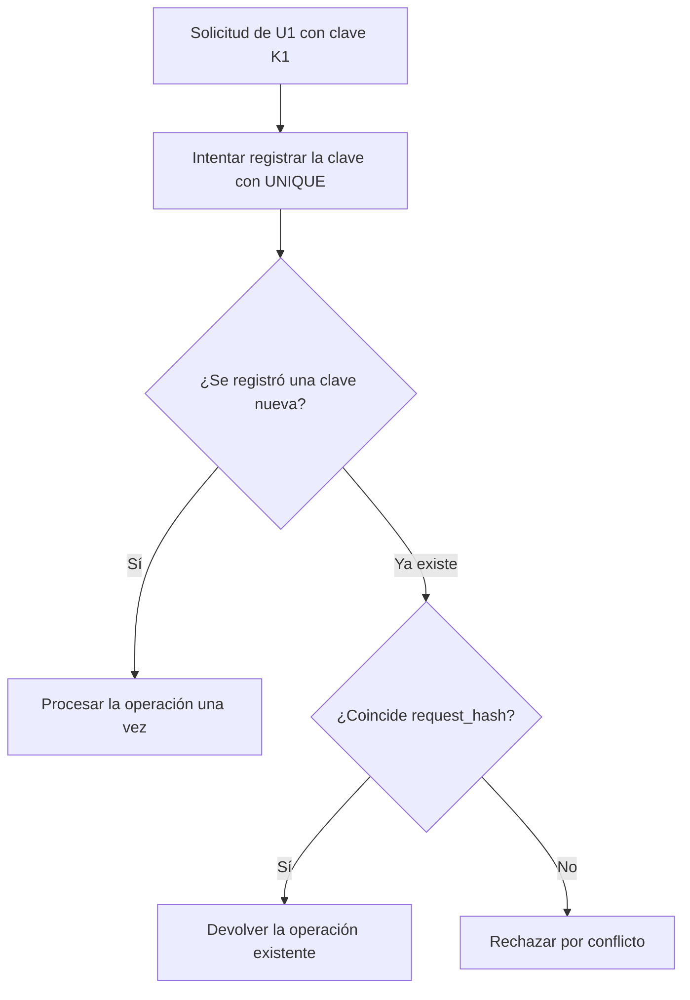

# Modelo lógico, atomicidad e idempotencia

Material para presentar y explicar la propuesta a Diego y al equipo.

**Estado:** diseño propuesto, pendiente de implementación y pruebas. **Supuesto del ejemplo:** transferencia interna entre dos cuentas distintas en ARS, sin comisiones, retenciones ni descubierto, registrada en nuestra PostgreSQL. Si el dinero lo administra un core externo, se debe revisar el flujo de confirmación.

La presentación se divide en tres láminas. El anexo conserva los detalles que conviene tener a mano para preguntas.

## Lámina 1. Entidades y relaciones

### Visual principal

El diagrama muestra campos seleccionados. El modelo completo conserva fechas, estados y datos de reversión detallados en el anexo.



### Leyenda del diagrama

Los símbolos en los extremos indican cardinalidad: cuántas filas pueden relacionarse. Son notación de pata de cuervo, no operadores lógicos OR o XOR.

| Símbolo a la derecha | Lectura |
|---|---|
| `\|\|` | Exactamente uno. |
| `o\|` | Cero o uno. |
| `o{` | Cero o muchos. |
| `\|{` | Uno o muchos. |

El círculo representa cero, la barra uno y la bifurcación muchos. Los símbolos se reflejan al cambiar de extremo: `}o` equivale a `o{`, y `|o` equivale a `o|`. Nuestro dibujo utiliza exactamente uno y cero o muchos.

**Ejemplo:** `USERS ||..o{ ACCOUNTS : posee` significa que un usuario puede tener cero o muchas cuentas, y cada cuenta pertenece a exactamente un usuario. Los símbolos junto a ACCOUNTS indican cuántas cuentas puede tener un usuario. Los símbolos junto a USERS indican cuántos usuarios corresponden a una cuenta.

**Trazo:** `--` representa una relación identificadora y `..` una no identificadora. Usamos líneas discontinuas porque cada tabla tiene su propio `id` como PK y las FK mostradas no forman parte de esa PK. Las referencias siguen siendo obligatorias según el modelo. El trazo no representa el flujo de una petición ni determina la opcionalidad. [Mermaid](https://mermaid.js.org/syntax/entityRelationshipDiagram.html) y [MySQL Workbench](https://dev.mysql.com/doc/workbench/en/wb-relationship-tools.html) documentan esta notación.

| Elemento dentro de las tablas | Significado |
|---|---|
| `PK` | Clave primaria: identifica una fila. |
| `FK` | Clave foránea: referencia una clave de otra tabla. |
| `uuid` | Tipo de identificador de 128 bits utilizado para los IDs. |
| `text` / `string` | Texto. La longitud y restricciones se detallan en el modelo completo. |
| `int` | Número entero, como el número de línea. |
| `numeric` | Decimal exacto, usado para el importe. |

Las palabras posee, inicia, recibe y agrupa describen la relación. No son instrucciones que se ejecuten.

La cardinalidad general permite cuentas sin movimientos y operaciones rechazadas sin entradas. Al confirmar una operación exigimos al menos dos entradas balanceadas. La transferencia simple de este ejemplo tiene exactamente dos.

### Qué explicar

| Entidad | Responsabilidad |
|---|---|
| `users` | Identifica al usuario dentro de nuestra aplicación. |
| `accounts` | Identifica la cuenta, su titular, moneda y estado. |
| `transactions` | Registra la operación completa, quién la inició y su resultado. |
| `ledger_entries` | Registra cuánto afecta esa operación a cada cuenta. |

`ledger_entries` es la cuarta entidad que propusimos para desglosar cada operación. Una transferencia puede llegar a una cuenta de otro usuario, por eso el iniciador no tiene que ser titular de todas las cuentas involucradas.

**Explicación oral sugerida:**

“Un usuario puede tener varias cuentas e iniciar varias operaciones. Cada operación agrupa movimientos sobre cuentas. Por ejemplo, una transferencia genera un movimiento negativo en el origen y uno positivo en el destino. Ambos pertenecen a la misma operación.”

### Ejemplo para señalar en pantalla

Operación T1: transferir **ARS 10.000** de A a B.

| `transaction_id` | `line_number` | `account_id` | `currency` | `amount` |
|---|---:|---|---|---:|
| T1 | 1 | A | ARS | −10.000,00 |
| T1 | 2 | B | ARS | +10.000,00 |

T1, A y B son identificadores abreviados para explicar el caso. En el modelo son UUID. `amount` utiliza `NUMERIC(20,2)` para este ejemplo. Los importes se muestran con formato local de lectura.

El saldo contable se calcula sumando entradas de la cuenta pertenecientes a operaciones `POSTED`. No almacenamos todavía un campo de saldo en `accounts`.

## Lámina 2. Atomicidad de la transferencia

### Visual principal

Este dibujo parte de una solicitud nueva, autenticada y autorizada, cuya clave ya reclamamos dentro de la misma transacción SQL. Se concentra en la contabilización y en los fallos técnicos anteriores al commit.



Si el error ocurre antes de llegar a la comprobación dibujada, también se aborta y revierte la transacción. Un rechazo de negocio, como fondos insuficientes, puede conservarse como `REJECTED` sin movimientos. Ese caso se documenta aparte del fallo técnico.

| Resultado | Cuenta A | Cuenta B |
|---|---:|---:|
| Antes del intento | 100.000,00 | 20.000,00 |
| T1 confirmada | 90.000,00 | 30.000,00 |
| T1 deshecha por fallo técnico | 100.000,00 | 20.000,00 |

**Explicación oral sugerida:**

“Guardamos la operación y sus movimientos dentro de una única transacción de PostgreSQL. Confirmamos todo junto. Si ocurre un fallo antes de confirmar, hacemos rollback y se deshacen las escrituras de ese intento. Así evitamos que quede un débito confirmado sin su crédito.”

La fila de `transactions` representa una operación de negocio. La transacción SQL es el mecanismo que agrupa las escrituras. Compartir un nombre no las convierte en lo mismo.

**Límite importante:** perder la respuesta después del commit no permite asumir que hubo rollback. Ese problema lo resuelve el tratamiento de reintentos de la siguiente lámina.

## Lámina 3. Idempotencia ante reintentos

### Visual principal

La app asigna una clave a una intención de transferencia y conserva esa clave cuando reintenta. El backend obtiene el usuario de la identidad autenticada y calcula un hash del contenido normalizado.



La base arbitra mediante esta restricción:

```sql
UNIQUE (initiated_by_user_id, idempotency_key)
```

La comprobación se hace al intentar registrar la clave, mediante una operación atómica protegida por la restricción. Una consulta previa aislada no impide carreras entre peticiones. Si la primera petición todavía está ejecutándose, el segundo intento debe resolver la espera o el conflicto con una política acotada y conservar la misma clave.

| Petición | Resultado esperado |
|---|---|
| U1, K1, A a B, ARS 10.000 por primera vez | Crear y procesar T1. |
| U1, K1, A a B, ARS 10.000 otra vez | Devolver T1 sin nuevos movimientos. |
| U1, K1, A a B, ARS 15.000 | Rechazar el cambio de contenido. |

**Explicación oral sugerida:**

“Si la app pierde la respuesta, reintenta con la misma clave. La base evita registrar otra operación para ese usuario y esa clave. Comparamos también el contenido: si coincide, devolvemos el resultado existente. Si cambió, rechazamos la solicitud.”

El hash incluye el tipo de operación, origen, destino, moneda e importe normalizados. No se toma como confiable un hash enviado por el cliente. La clave no reemplaza la autenticación ni la autorización.

La política de conservación de claves debe cubrir los reintentos admitidos. Un reintento después de un resultado incierto conserva la clave original.

## Concurrencia: respuesta que conviene preparar

Idempotencia distingue reintentos de una misma intención. Dos transferencias distintas tienen claves distintas y pueden competir por el mismo saldo.

Para esta propuesta usamos `READ COMMITTED`. Todos los escritores bloquean las cuentas involucradas en un orden común y vuelven a consultar el saldo después de adquirir esos bloqueos, en una sentencia nueva. La comprobación y las escrituras permanecen dentro de la misma transacción SQL.

**Ejemplo:** A tiene 100.000 y llegan solicitudes por 80.000 y 70.000. Si la primera confirma 80.000, la segunda encuentra 20.000 al conseguir el bloqueo y rechaza los 70.000.

Bloquear una fila de cuenta no protege automáticamente cualquier escritura en el ledger. Todos los caminos de contabilización deben cumplir el protocolo y se deben restringir las escrituras que puedan eludirlo. Los tiempos máximos de espera y los reintentos por abortos quedan por implementar.

## Anexo técnico para preguntas

### Campos del modelo propuesto

| Entidad | Campos |
|---|---|
| `users` | `id UUID PK`, `auth_issuer TEXT`, `auth_subject VARCHAR(255)`, `status`, `created_at TIMESTAMPTZ`. |
| `accounts` | `id UUID PK`, `user_id UUID FK`, `currency VARCHAR(3)`, `status`, `created_at TIMESTAMPTZ`. |
| `transactions` | `id UUID PK`, `initiated_by_user_id UUID FK`, `operation_type`, `status`, `currency VARCHAR(3)`, `idempotency_key VARCHAR(128)`, `request_hash TEXT`, `created_at TIMESTAMPTZ`, `posted_at TIMESTAMPTZ`, `rejection_code`, `reversal_of_id UUID FK`. |
| `ledger_entries` | `id UUID PK`, `transaction_id UUID`, `account_id UUID`, `line_number INTEGER`, `currency VARCHAR(3)`, `amount NUMERIC(20,2)`. |

Los campos son obligatorios salvo los condicionales: `posted_at` corresponde a operaciones `POSTED`, `rejection_code` a operaciones `REJECTED` y `reversal_of_id` a reversiones. Los tipos de texto de estados y códigos se concretarán al implementar el esquema. La precisión monetaria debe validarse contra las monedas admitidas.

### Restricciones y responsabilidades

| Regla | Mecanismo propuesto |
|---|---|
| Una identidad externa por usuario local | `UNIQUE(auth_issuer, auth_subject)`. |
| Una clave de idempotencia por usuario | `UNIQUE(initiated_by_user_id, idempotency_key)` y comparación de `request_hash`. |
| Una numeración de entradas por operación | `UNIQUE(transaction_id, line_number)`, con número de línea positivo. |
| Cuenta y operación con la moneda de cada entrada | FK compuestas `(account_id, currency)` y `(transaction_id, currency)`, con `UNIQUE(id, currency)` en las tablas referenciadas. |
| Importes válidos | Decimales exactos, finitos y distintos de cero en las entradas. Importe positivo en la solicitud y escala validada antes de guardar. |
| Confirmación balanceada | Al menos dos entradas cuya suma sea cero por operación y moneda. En la transferencia simple se exigen exactamente dos, por el importe autorizado. |
| Estados coherentes | Usuarios ACTIVE/BLOCKED. Cuentas ACTIVE/BLOCKED/CLOSED. Operaciones PENDING/POSTED/REJECTED. Tipos TRANSFER/REVERSAL. |
| Historial conservado | Impedir cambios o borrados de operaciones confirmadas y sus movimientos. Corregir mediante operaciones compensatorias autorizadas. |
| Reversión completa única | Como máximo una reversión completa confirmada por original, con validaciones e índice condicional a concretar. |

Las claves foráneas protegen relaciones, pero no conceden permisos. El backend comprueba que el iniciador esté autorizado a operar la cuenta origen.

La suma de varias filas no se impone mediante un `CHECK` ordinario. Se debe implementar una vía de contabilización con escrituras restringidas y una comprobación de invariantes adecuada al commit. Tampoco basta con que la suma sea cero para demostrar que las cuentas y el importe eran los autorizados.

En esta propuesta, `PENDING` es transitorio dentro de la transacción SQL. No diseñamos todavía un procesador asíncrono que confirme pendientes y los resuelva más tarde.

## Verificaciones previstas

| Caso | Evidencia esperada |
|---|---|
| Fallo entre la primera y la segunda entrada | No queda un débito confirmado aislado. |
| Reintentos simultáneos con la misma clave y contenido | Una sola operación efectiva. |
| Clave reutilizada con otro importe | Conflicto y ningún movimiento adicional. |
| Respuesta perdida después del commit | El reintento recupera la operación ya confirmada. |
| Dos operaciones distintas compitiendo por saldo | No confirman ambas si los fondos no alcanzan. |

Estas verificaciones están planificadas. Los diagramas describen la propuesta y no constituyen evidencia de implementación.

## Orden de exposición

1. Mostrar las relaciones y explicar qué representa cada entidad.
2. Señalar T1 y sus dos movimientos en el ejemplo numérico.
3. Explicar qué ocurre al confirmar o revertir las escrituras.
4. Simular una respuesta perdida y el reintento con K1.
5. Mencionar el control de concurrencia y las verificaciones pendientes.

Mantener el mismo ejemplo, nombres e importes en las tres láminas evita que el público tenga que aprender un caso nuevo en cada visual.

## Referencias

- [PostgreSQL: transacciones](https://www.postgresql.org/docs/current/tutorial-transactions.html).
- [PostgreSQL: restricciones](https://www.postgresql.org/docs/current/ddl-constraints.html).
- [PostgreSQL: INSERT y ON CONFLICT](https://www.postgresql.org/docs/current/sql-insert.html).
- [PostgreSQL: bloqueos explícitos](https://www.postgresql.org/docs/current/explicit-locking.html).
- [PostgreSQL: aislamiento de transacciones](https://www.postgresql.org/docs/current/transaction-iso.html).
