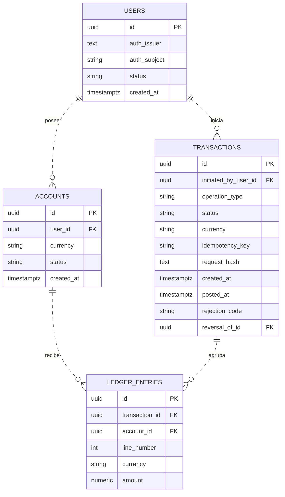
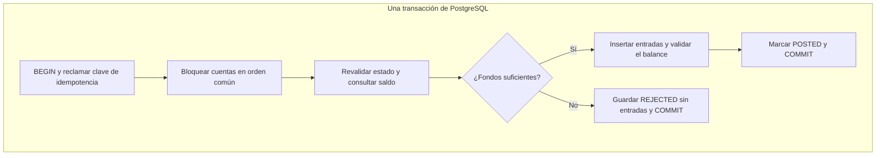

# Modelo lógico de transferencias

Propongo un **ledger de partida doble en PostgreSQL**: cada operación confirmada agrupa movimientos contables balanceados y conserva su historial. Esta es la base para revisar con Diego y el equipo.

**Estado:** diseño propuesto; implementación y pruebas pendientes.

**Alcance:** transferencias internas en ARS entre dos cuentas de clientes distintas y activas, sin comisiones, retenciones ni descubierto.

**Supuesto:** PostgreSQL es el registro autoritativo del dinero. Si un core externo ejecuta las operaciones, debemos revisar la confirmación, los estados y la conciliación; una transacción SQL local no garantiza el resultado externo.

## 1. Entidades y claves

| Entidad | Responsabilidad |
|---|---|
| `users` | Vincula la identidad del proveedor con el usuario local. |
| `accounts` | Identifica la cuenta del cliente, su titular, moneda y estado. |
| `transactions` | Agrupa la operación, su resultado y los datos de idempotencia. |
| `ledger_entries` | Registra cada débito o crédito de la operación. |

**Lectura:** `PK` es clave primaria y `FK`, foránea. `||` significa exactamente uno; `o{`, cero o muchos. Las líneas discontinuas indican relaciones no identificadoras: las FK mostradas no forman parte de la PK. Una cuenta puede no tener movimientos; una operación rechazada no tiene entradas.

**Tipos:** identificadores `UUID`; fechas `TIMESTAMPTZ`; `amount NUMERIC(20,2)`; moneda `VARCHAR(3)`; `auth_subject VARCHAR(255)`; `idempotency_key VARCHAR(128)`. `string` representa texto en el diagrama.

Los campos son obligatorios salvo `posted_at`, `rejection_code` y `reversal_of_id`, que corresponden respectivamente a confirmaciones, rechazos y reversiones. `reversal_of_id` referencia `transactions.id`.

## 2. Partida doble y saldo

Por operación y moneda, **total de débitos = total de créditos**. Para la transferencia simple se exigen dos entradas: una en el origen y otra en el destino, por el importe autorizado.

Vemos las cuentas de clientes desde la entidad: sus saldos son pasivos, porque representan dinero que esta les debe. En este modelo, `amount` negativo codifica un débito y positivo, un crédito. Para estas cuentas, el débito reduce el saldo y el crédito lo aumenta.

**Ejemplo: T1 transfiere ARS 10.000 de A a B.**

| Operación | Línea | Cuenta | Moneda | `amount` | Interpretación |
|---|---:|---|---|---:|---|
| T1 | 1 | A | ARS | −10.000,00 | Débito al origen. |
| T1 | 2 | B | ARS | +10.000,00 | Crédito al destino. |

T1, A y B abrevian UUID. La suma es cero; la columna de interpretación explica el signo y no se almacena.

El saldo de una cuenta de cliente es la suma de sus entradas vinculadas a operaciones `POSTED`, incluida su apertura. `accounts` no almacena un saldo separado. Si incorporamos cuentas de otra naturaleza, deberemos adaptar el cálculo: por ejemplo, un débito aumenta el saldo de un activo.

**Límite del modelo:** falta definir las cuentas internas y las contrapartidas de apertura. El `user_id` obligatorio actual solo representa cuentas de clientes. Esta ampliación es necesaria para registrar fondos iniciales, depósitos o retiros.

## 3. Confirmación de una transferencia

Precondiciones: usuario autenticado y activo, autorización para debitar el origen, cuentas distintas y activas, moneda admitida e importe válido. El destino puede pertenecer a otro usuario.

Para una solicitud nueva, todas las escrituras se realizan dentro de **una transacción SQL**:

Un fallo técnico antes del commit provoca `ROLLBACK` de todo el intento, incluida la clave reclamada. Si el commit se completó pero se perdió la respuesta, la operación sigue confirmada: el cliente reintenta con la misma clave.

| Estado | Significado |
|---|---|
| `PENDING` | Preparación transitoria dentro de la transacción SQL. |
| `POSTED` | Operación confirmada con sus entradas completas. |
| `REJECTED` | Rechazo de negocio registrado sin entradas. |

La fila de `transactions` identifica la operación de negocio; la transacción SQL garantiza que sus escrituras se confirmen juntas. El procesamiento asíncrono queda fuera de este alcance.

### Idempotencia: evitar duplicados

La app conserva una clave por intención de transferencia. El backend obtiene el usuario del token validado y calcula `request_hash` con tipo de operación, origen, destino, moneda e importe normalizados.

| Resultado de reclamar la clave | Acción |
|---|---|
| Clave nueva | Procesar la transferencia. |
| Clave existente y mismo hash | Devolver la operación registrada, sin nuevos movimientos. |
| Clave existente y distinto hash | Rechazar por conflicto. |

La restricción `UNIQUE(initiated_by_user_id, idempotency_key)` resuelve la competencia entre peticiones. La reclamación debe usarla atómicamente; consultar y luego insertar sin gestionar el conflicto no alcanza. Si otra petición sigue ejecutándose, se aplicará una espera acotada y una política de reintento por definir.

### Concurrencia: proteger el saldo

Para operaciones distintas propongo `READ COMMITTED` y bloqueo de todas las cuentas involucradas, siempre en el mismo orden. Después de adquirir los bloqueos, una sentencia nueva revalida su estado y consulta el saldo; los bloqueos se mantienen hasta finalizar la transacción.

Todos los procesos que contabilicen deben seguir este protocolo. Hay que restringir las escrituras directas que lo eludan: el bloqueo de una cuenta no impide por sí solo insertar entradas desde otro proceso.

## 4. Restricciones del modelo

| Regla | Mecanismo propuesto |
|---|---|
| Identidad local única | `UNIQUE(auth_issuer, auth_subject)`, correspondientes a `(iss, sub)` validados. |
| Idempotencia por usuario | `UNIQUE(initiated_by_user_id, idempotency_key)` y comparación del hash calculado por el servidor. |
| Numeración de entradas | `UNIQUE(transaction_id, line_number)` y línea positiva. |
| Moneda coherente | FK compuestas `(account_id, currency)` y `(transaction_id, currency)`; `UNIQUE(id, currency)` en sus tablas de destino. |
| Importes válidos | Decimales exactos, finitos y no nulos ni cero; solicitud positiva y escala validada antes de guardar. |
| Operación balanceada | Suma con signo igual a cero por operación y moneda. Dos entradas para esta transferencia, con cuentas e importe autorizados. |
| Estados y tipos válidos | Usuarios: ACTIVE/BLOCKED. Cuentas: ACTIVE/BLOCKED/CLOSED. Operaciones: PENDING/POSTED/REJECTED. Tipos: TRANSFER/REVERSAL. |
| Historial confirmado conservado | Impedir cambios y borrados de operaciones `POSTED` y sus entradas. |
| Reversión completa única | Como máximo una reversión completa confirmada por original; autorización e índice condicional por concretar. |

El balance entre varias filas requiere una rutina de contabilización y/o validación diferida en la base; un `CHECK` ordinario no alcanza. Los mecanismos concretos y los permisos de escritura siguen pendientes de implementación.

## 5. Reconstrucción, auditoría y recuperación

- **Correcciones:** crear una operación compensatoria autorizada con `reversal_of_id`. La original conserva su estado `POSTED`; el saldo incluye ambas operaciones.
- **Reconstrucción:** recalcular desde un historial completo y un corte consistente, sin volver a ejecutar transferencias. Un saldo precalculado futuro debe ser verificable contra ese mismo corte.
- **Consultas históricas:** distinguir la fecha efectiva del movimiento de cuándo se registró. Las fechas y el orden del corte siguen pendientes; `posted_at` no garantiza el orden de commit.
- **Auditoría:** registrar identificador, fecha, actor, acción, recurso, resultado, `request_id` y operación cuando exista. Las confirmaciones deben quedar consistentes con el commit; los intentos fallidos necesitan un registro que sobreviva al rollback y no los presente como movimientos confirmados.
- **Protección:** restringir cambios y accesos al historial, contemplar alteraciones privilegiadas y excluir tokens, contraseñas y datos sensibles innecesarios de los registros.
- **Recuperación:** respaldos, archivado de WAL cuando corresponda y pruebas de restauración, con pérdida máxima de datos y tiempo de recuperación acordados. El WAL no sustituye la auditoría de negocio.
- **Conciliación:** si interviene un core externo, contrastar sus identificadores y resultados con los nuestros; reconstruir la base local no confirma una ejecución externa.

## 6. Pendientes para acordar con el equipo

| Decisión | Qué falta definir |
|---|---|
| Autoridad sobre el dinero | Registro local o integración con un core externo. |
| Cobertura contable | Plan mínimo de cuentas, cuentas internas, apertura y permisos; confirmar monedas, comisiones y descubierto. |
| Garantías en la base | Contabilización, inmutabilidad, estados y reversiones completas. |
| Reintentos | Tiempos de bloqueo, recuperación de abortos y conservación de claves de idempotencia. |
| Trazabilidad y recuperación | Esquema de auditoría, fechas y cortes, retención, protección y objetivos de restauración y conciliación. |

## 7. Verificaciones previstas

| Caso | Resultado esperado |
|---|---|
| Fallo entre entradas o importes desbalanceados | Ningún movimiento parcial confirmado. |
| Reintentos simultáneos con la misma clave | Una sola operación efectiva. |
| Misma clave con distinto contenido | Conflicto, sin nuevos movimientos. |
| Respuesta perdida después del commit | El reintento recupera la operación existente. |
| Transferencias distintas compiten por saldo | No confirman ambas si los fondos no alcanzan. |
| Reconstrucción con apertura y reversión | Saldo correcto para el corte elegido; original y compensación conservadas. |
| Rechazo o rollback | Auditoría del intento, sin presentarlo como confirmación. |
| Edición de entradas confirmadas desde la aplicación | Escritura rechazada. |
| Restauración y reconstrucción | Historial recuperado y verificado hasta el punto acordado. |

Estas verificaciones están previstas; aún no se ejecutaron.

## Referencias

- [Modern Treasury: transacciones de ledger y partida doble](https://docs.moderntreasury.com/ledgers/docs/ledger-transactions-overview).
- [TigerBeetle: naturaleza de las cuentas, débitos y créditos](https://docs.tigerbeetle.com/coding/financial-accounting/).
- [Mermaid: entidades y relaciones](https://mermaid.js.org/syntax/entityRelationshipDiagram.html).
- PostgreSQL: [transacciones](https://www.postgresql.org/docs/current/tutorial-transactions.html), [restricciones](https://www.postgresql.org/docs/current/ddl-constraints.html), [INSERT y ON CONFLICT](https://www.postgresql.org/docs/current/sql-insert.html), [bloqueos](https://www.postgresql.org/docs/current/explicit-locking.html) y [aislamiento](https://www.postgresql.org/docs/current/transaction-iso.html).
- [PostgreSQL: archivado continuo y recuperación](https://www.postgresql.org/docs/current/continuous-archiving.html).
- [OWASP: registro de eventos](https://cheatsheetseries.owasp.org/cheatsheets/Logging_Cheat_Sheet.html).
