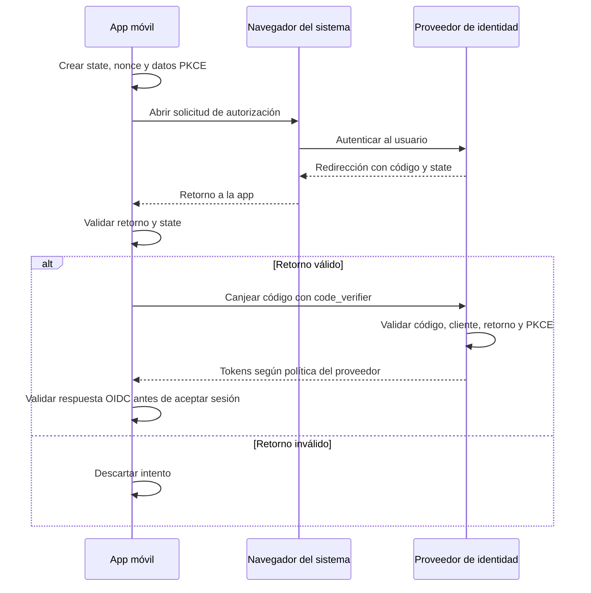

# 03 · Autenticación y sesión

El proveedor de identidad autentica al usuario; el backend decide qué puede hacer sobre cada recurso. **Autenticación** responde quién opera y **autorización**, si puede realizar esa acción sobre esa cuenta.

**Estado:** diseño para Android e iOS. Proveedor, bibliotecas, configuración y pruebas por plataforma siguen pendientes.

## 1. Protocolos y tokens

OAuth 2.0 organiza el acceso autorizado a recursos; **OpenID Connect (OIDC)** agrega el inicio de sesión y la información de identidad. La app se registra como cliente público: no lleva un `client_secret` que deba mantenerse confidencial.

| Token | Uso | Manejo propuesto |
|---|---|---|
| **Access token** | Acceder a la API mediante `Authorization: Bearer`. | En memoria; JWT firmado en esta propuesta. La API valida su firma y claims —campos del token—. |
| **Refresh token** | Pedir nuevos tokens al proveedor. | Persistido con protección de la plataforma. Nunca se envía a la API de negocio. |
| **ID token** | Comunicar a la app el resultado del login OIDC. | Validado por la biblioteca OIDC; no sirve como credencial de la API. |

La app trata el access token como un valor opaco y usa `expires_in` para gestionar el vencimiento. Un JWT es un formato, no una autorización automática. El refresh token no necesita ser JWT y su emisión depende del proveedor.

## 2. Login con Authorization Code + PKCE

La app utiliza una biblioteca OIDC mantenida y el navegador o sesión de autenticación del sistema. Las credenciales se introducen en el proveedor.

| Valor | Qué protege |
|---|---|
| `state` | Vincula el retorno con el intento iniciado. |
| PKCE `S256` | Vincula el canje del código a quien conoce el `code_verifier` generado al iniciar. |
| `nonce` | Vincula el ID token validado con ese intento de autenticación. |

La solicitud usa cliente y redirección registrados, `response_type=code`, `scope=openid` y permisos de API. URLs y emisor provienen de configuración confiable. `state`, `nonce` y verificador se generan por intento y se descartan al finalizar. La biblioteca valida también firma, emisor, audiencia y vigencia del ID token. Una cancelación o validación fallida no crea sesión.

Los campos de solicitud y respuesta se detallan en [contratos](04-contratos-api.md#2-intercambios-con-el-proveedor-de-identidad).

## 3. Validación y autorización en cada petición

El gateway aplica controles de entrada. El backend mantiene estas verificaciones mediante una biblioteca:

| Control | Regla |
|---|---|
| Firma y algoritmo | Clave confiable y algoritmo permitido explícitamente; rechazar `none`. |
| Emisor y audiencia | `iss` debe corresponder al IdP configurado; `aud`, a nuestra API. |
| Vigencia y perfil | Revisar `exp`, `nbf` cuando exista, tolerancia de reloj acotada y claims/tipo exigidos. Si se adopta RFC 9068, aplicar su perfil completo, incluido `typ`. |
| Usuario local | Resolver `(iss, sub)` contra `auth_issuer` y `auth_subject`; comprobar que esté activo. |
| Permisos | Comprobar permiso funcional y acceso a la cuenta solicitada. |

Las claves públicas —JWKS— se obtienen de la configuración confiable del emisor, con caché y rotación. No se siguen URLs arbitrarias del token. Un `user_id` o encabezado aportado por el cliente no cambia la identidad validada; si el token no puede verificarse, se rechaza el acceso.

**Ejemplo:** un token válido de A no permite consultar la cuenta de B. La falta de autenticación devuelve `401`; la falta de permiso funcional, `403`; una cuenta inexistente o ajena, el mismo `404`. Los cuerpos y acciones del cliente están en [04](04-contratos-api.md#4-errores-comunes).

### Identidad del asistente

El chat aplica los mismos controles y vincula cada conversación al usuario local. Conocer un `conversation_id` no autoriza a leerla. Cada función recibe del servidor el contexto de usuario y vuelve a comprobar permisos; lo escrito en el chat o sugerido por Gemini no los amplía.

Gemini usa una credencial técnica del backend gestionada mediante HashiCorp Vault; los tokens del usuario quedan fuera del contexto enviado al modelo. La confirmación de una transferencia requiere una solicitud separada, vinculada a los datos exactos y al step-up exigido. Una frase del chat o un booleano del cliente no acredita esa autorización.

## 4. Renovación y almacenamiento

Se propone rotación de refresh tokens con detección de reutilización en el proveedor:

1. Coordinar **una sola renovación por sesión**, aunque varias peticiones la necesiten.
2. Validar la respuesta y reemplazar el refresh token antes de permitir otra renovación.
3. Reintentar la petición original como máximo una vez por este motivo; una escritura conserva contenido y clave de idempotencia.
4. Ante rechazo definitivo del proveedor, limpiar la sesión y pedir login.

Un `403` no dispara renovación. Un fallo de red no demuestra que el token sea inválido. Si se pierde la respuesta de una rotación, no se reutiliza a ciegas el token anterior: la recuperación depende de la política del proveedor y la biblioteca.

| Plataforma | Protección del refresh token | Condiciones a comprobar |
|---|---|---|
| **iOS** | Keychain. Clase candidata: `kSecAttrAccessibleWhenPasscodeSetThisDeviceOnly`. | Requiere código y desbloqueo, no migra a otro dispositivo y se elimina al quitar el código. Validar compatibilidad con segundo plano. |
| **Android** | Token cifrado en almacenamiento separado, con claves protegidas por Android Keystore. Integración mantenida por seleccionar. | Versiones mínimas, copias/restauración, acceso bloqueado, invalidación de claves y borrado al salir. |

`EncryptedSharedPreferences` está deprecado; su reemplazo sigue pendiente. Keystore protege claves, no almacena por sí mismo el token. No guardar credenciales en texto claro en preferencias comunes, AsyncStorage, logs o analítica.

Si el almacenamiento está temporalmente inaccesible, se maneja esa condición sin reducir su protección. Ante pérdida o invalidación permanente de la clave, limpiar credenciales y solicitar login. Al reiniciar, la app puede intentar renovar si conserva un refresh token accesible.

## 5. Cierre de sesión

Detener renovaciones, impedir que respuestas tardías restauren la sesión, solicitar revocación del refresh token y borrar credenciales locales aunque falle esa solicitud. Limpiar el contexto local del chat y descartar respuestas de la sesión cerrada.

El cierre local no prueba una revocación remota. Un access token JWT puede seguir válido hasta vencer si no existe invalidación adicional. Cerrar la sesión del navegador en el IdP es otro paso, a integrar si se requiere. Al recuperar conversaciones en un nuevo login se vuelve a comprobar su propietario.

## 6. Pendientes y comprobaciones

Faltan proveedor y bibliotecas; clientes, redirecciones, audiencia y scopes; alta del usuario local; duración, inactividad, MFA y step-up; recuperación de rotaciones; política de Keychain y solución Android; autenticación técnica ante Vault y retención del chat.

Las verificaciones deben cubrir login y retorno en ambas plataformas, rechazo de tokens inválidos, aislamiento entre usuarios, renovación concurrente, logout durante una renovación y pérdida de acceso al almacenamiento. Los escenarios y evidencias se concentran en [STRIDE](05-threat-model.md), TM-01–TM-04, TM-11, TM-14 y TM-18.

## Para profundizar

- IETF: [OAuth para apps nativas](https://datatracker.ietf.org/doc/html/rfc8252), [PKCE](https://datatracker.ietf.org/doc/html/rfc7636), [seguridad OAuth](https://www.rfc-editor.org/rfc/rfc9700.html) y [buenas prácticas JWT](https://datatracker.ietf.org/doc/html/rfc8725).
- [OIDC Core](https://openid.net/specs/openid-connect-core-1_0.html) y [perfil de access tokens JWT](https://datatracker.ietf.org/doc/html/rfc9068).
- Apple: [clase de accesibilidad Keychain](https://developer.apple.com/documentation/security/ksecattraccessiblewhenpasscodesetthisdeviceonly).
- Android: [Keystore](https://developer.android.com/privacy-and-security/keystore) y [estado de EncryptedSharedPreferences](https://developer.android.com/reference/androidx/security/crypto/EncryptedSharedPreferences).
