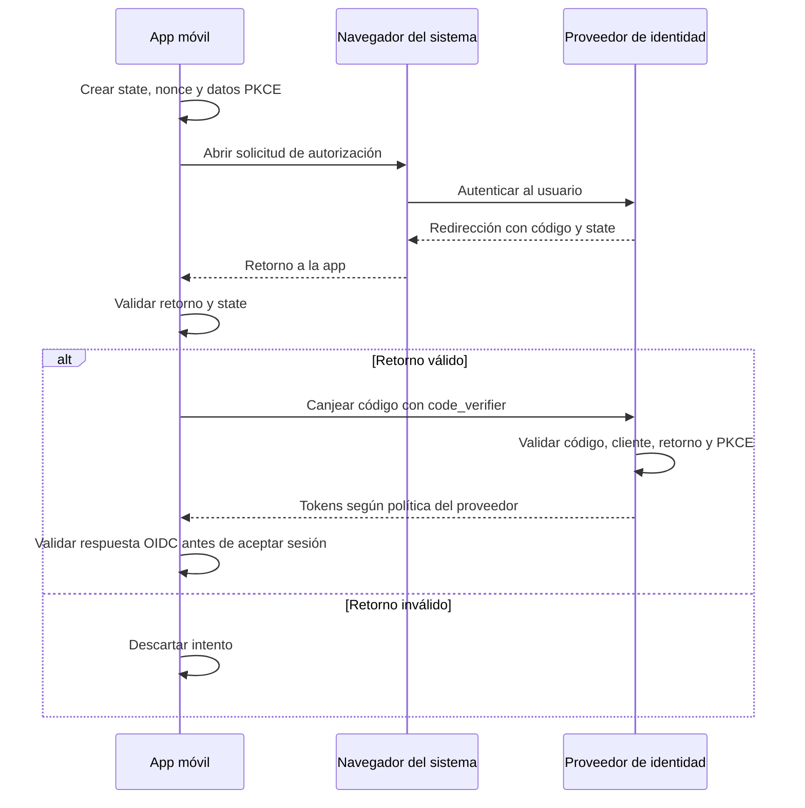
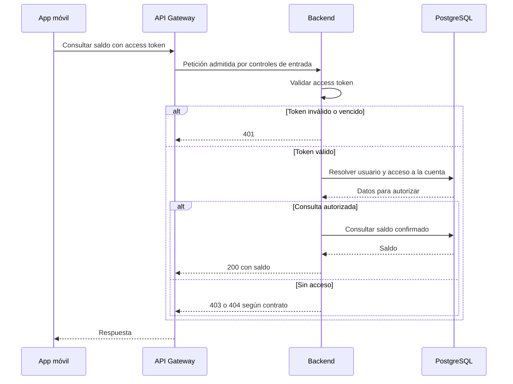

# Autenticación y sesión

Propongo delegar el inicio de sesión en un **proveedor de identidad compatible con OpenID Connect (OIDC)**. El backend valida el acceso a la API y autoriza cada operación sobre cuentas y recursos.

**Estado:** diseño propuesto; proveedor, configuración, implementación y pruebas pendientes.

**Alcance:** app móvil nativa, API Gateway y backend del diagrama general.

## 1. Responsabilidades y tokens

| Componente | Responsabilidad |
|---|---|
| App móvil | Iniciar el login, validar el retorno con una biblioteca OIDC y gestionar la sesión. |
| Proveedor de identidad | Autenticar al usuario, aplicar MFA según la política acordada y emitir, renovar y revocar tokens. |
| API Gateway | Aplicar controles generales de entrada y dirigir las peticiones al backend. |
| Backend | Validar el access token, resolver el usuario local y comprobar permisos por recurso. |

| Token | Para qué se utiliza | Manejo en la app |
|---|---|---|
| **Access token** | Acceder a nuestra API con `Authorization: Bearer <access_token>`. | En memoria; usar `expires_in` para gestionar su vencimiento. |
| **Refresh token** | Obtener nuevos tokens en el proveedor. | En Keychain; nunca enviarlo a la API de negocio. |
| **ID token** | Comunicar a la app el resultado de la autenticación OIDC. | Validarlo con la biblioteca OIDC; no usarlo para acceder a nuestra API. |

Propongo access tokens JWT firmados, con perfil por acordar. La app los trata como valores opacos; el backend los valida. El refresh token no necesita ser JWT. [3][4]

## 2. Inicio de sesión

El flujo propuesto es **Authorization Code con PKCE S256**, mediante el navegador o la sesión de autenticación del sistema y una biblioteca OIDC mantenida. La app es un cliente público: no depende de un `client_secret` confidencial. Las credenciales se introducen en el proveedor. [1][2]

La solicitud incluye cliente y redirección registrados, `response_type=code`, `scope=openid`, permisos de API, `state`, `nonce` y el desafío PKCE `S256`. Las URLs provienen de configuración confiable. Los valores temporales se generan por intento y se descartan al finalizarlo. [2][3]

| Comprobación | Propósito |
|---|---|
| `state` | Vincular el retorno con el intento iniciado. |
| PKCE | El proveedor verifica que quien canjea el código conoce su `code_verifier`. |
| ID token y `nonce` | Validar criptográficamente el ID token, su emisor, audiencia de la app, vigencia y vinculación con el intento, conforme a OIDC. |

Una cancelación o un error termina el intento sin crear sesión. La emisión del refresh token depende de la política del proveedor.

## 3. Acceso a la API

En **cada petición protegida**, el backend aplica estas comprobaciones mediante una biblioteca de validación: [4][5]

| Control | Regla |
|---|---|
| Firma y algoritmo | Clave confiable y algoritmo permitido explícitamente; rechazar `none`. |
| Emisor y audiencia | `iss` coincide con el proveedor configurado y `aud` incluye nuestra API. |
| Vigencia y perfil | Verificar `exp`, `nbf` cuando exista, tolerancia de reloj acotada y claims/tipo exigidos. Si adoptamos RFC 9068, aplicar el perfil completo, incluido `typ`. |
| Usuario local | Resolver `(iss, sub)` contra `users.auth_issuer` y `users.auth_subject`; comprobar que esté activo. |
| Autorización | Verificar permiso funcional y acceso a la cuenta solicitada. |

La identidad se obtiene del token validado. Un `user_id` enviado por el cliente no determina quién opera. Las claves públicas se obtienen de la configuración confiable del emisor, con caché y actualización para la rotación; no de URLs arbitrarias incluidas en el token. Si no se puede validar, se rechaza. [5]

**Ejemplo: consulta de saldo.**

Criterio propuesto: `401` para autenticación inválida; `403` para falta de permiso funcional; `404` para cuenta inexistente o no accesible. Los cuerpos de error se definirán en el contrato de API.

## 4. Renovación, almacenamiento y cierre

### Renovación

Propongo refresh tokens con **rotación y detección de reutilización** en el proveedor. [6]

1. Coordinar una sola renovación por sesión, aunque varias peticiones la necesiten.
2. Solicitar nuevos tokens, validar la respuesta y reemplazar de forma coordinada el refresh token antes de permitir otra renovación.
3. Reintentar la petición original como máximo una vez por este motivo. En escrituras, conservar clave de idempotencia y contenido.
4. Ante rechazo definitivo del proveedor, limpiar la sesión y solicitar login.

Un `403` no dispara renovación. Un `401` requiere evaluar si la sesión es renovable, sin bucles. Si se pierde la respuesta de una rotación, no se reutiliza a ciegas el token anterior: la recuperación debe seguir la política del proveedor y la biblioteca. Un fallo de red no demuestra que el token sea inválido.

### Almacenamiento en iOS

Access token en memoria y refresh token en **Keychain**. Al reiniciar, la app intenta renovar si dispone del refresh token y puede acceder a él.

Clase candidata: `kSecAttrAccessibleWhenPasscodeSetThisDeviceOnly`. Sus elementos requieren código del dispositivo y desbloqueo, no migran a otro dispositivo y se eliminan al quitar el código. Su compatibilidad con ejecución en segundo plano queda por validar. [7]

Si Keychain no está accesible, se maneja esa condición sin copiar credenciales a preferencias comunes. Contraseñas, códigos de autorización y tokens completos quedan fuera de logs y analítica.

### Cierre de sesión

Detener renovaciones, impedir que una respuesta tardía restaure la sesión, solicitar la revocación del refresh token y borrar credenciales locales incluso si esa solicitud falla.

El cierre local no confirma una revocación remota fallida. Un access token JWT puede seguir válido hasta vencer sin invalidación adicional. La sesión del navegador en el proveedor tiene un cierre separado, a integrar si se requiere. [8][9]

## 5. Pendientes para acordar con el equipo

| Decisión | Qué falta definir |
|---|---|
| Integración OIDC | Proveedor, biblioteca, clientes registrados, redirecciones, audiencias, permisos y perfil del access token. |
| Identidad local | Alta y vinculación estable del usuario con `(iss, sub)`. |
| Política de sesión | Duración, inactividad, MFA y reautenticación para operaciones sensibles. |
| Renovación y cierre | Recuperación de respuestas perdidas, invalidación inmediata y alcance del cierre en el proveedor. |
| Dispositivo | Política de Keychain, segundo plano y necesidad de vincular tokens criptográficamente al cliente o dispositivo. |

## 6. Verificaciones previstas

| Caso | Resultado esperado |
|---|---|
| `state`, `nonce` o PKCE incorrectos | El flujo se rechaza en la validación correspondiente. |
| Firma, emisor, audiencia o vigencia inválidos; ID token enviado a la API | La API rechaza la credencial. |
| Usuario consulta una cuenta ajena | No se devuelve información de esa cuenta. |
| Varias peticiones necesitan renovar | Una sola renovación en curso. |
| Respuesta de renovación perdida | Recuperación acordada, sin reintentos ciegos. |
| Logout durante una renovación | La respuesta tardía no restaura la sesión. |
| Keychain no accesible | No se reduce la protección del almacenamiento. |

Estas verificaciones están previstas; aún no se ejecutaron.

## Referencias

1. [RFC 8252: OAuth 2.0 para aplicaciones nativas](https://datatracker.ietf.org/doc/html/rfc8252).
2. [RFC 7636: PKCE](https://datatracker.ietf.org/doc/html/rfc7636).
3. [OpenID Connect Core 1.0](https://openid.net/specs/openid-connect-core-1_0.html).
4. [RFC 9068: perfil JWT para access tokens](https://datatracker.ietf.org/doc/html/rfc9068).
5. [RFC 8725: buenas prácticas para JWT](https://datatracker.ietf.org/doc/html/rfc8725).
6. [RFC 9700: seguridad de OAuth 2.0](https://www.rfc-editor.org/info/rfc9700/).
7. [Apple: kSecAttrAccessibleWhenPasscodeSetThisDeviceOnly](https://developer.apple.com/documentation/security/ksecattraccessiblewhenpasscodesetthisdeviceonly).
8. [RFC 7009: revocación de tokens](https://datatracker.ietf.org/doc/html/rfc7009).
9. [OpenID Connect: RP-Initiated Logout](https://openid.net/specs/openid-connect-rpinitiated-1_0.html).
