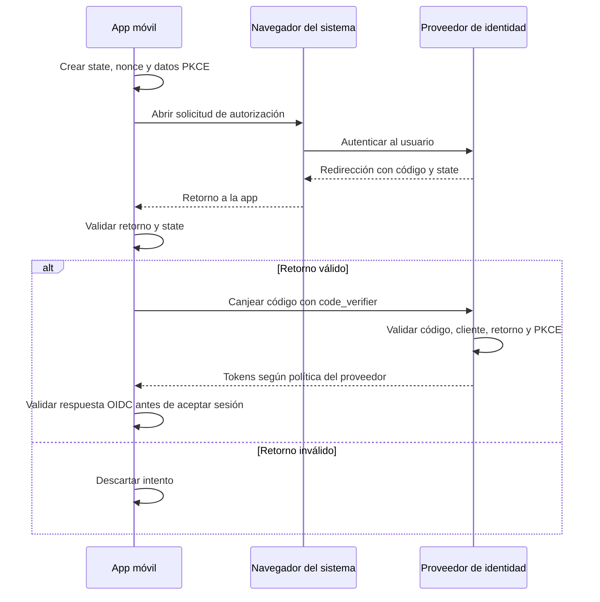
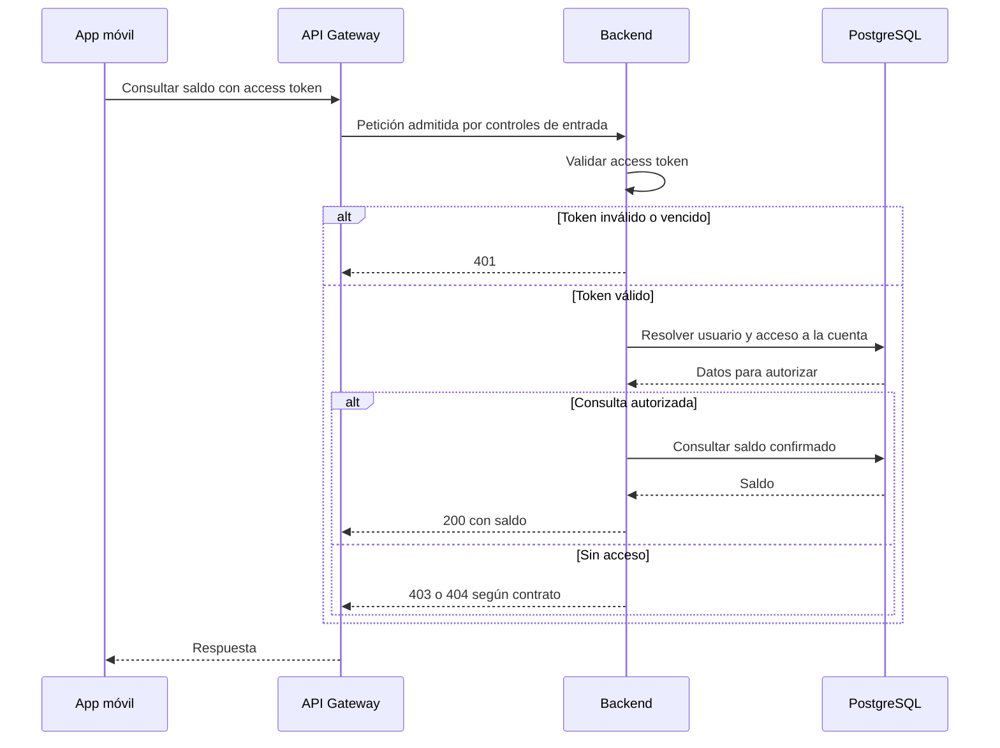

# 03 · Autenticación y sesión

Propongo delegar el inicio de sesión en un **proveedor de identidad compatible con OpenID Connect (OIDC)**. El backend valida el acceso a la API y autoriza cada operación sobre cuentas y recursos.

**Estado:** diseño propuesto; proveedor, configuración, implementación y pruebas pendientes.

**Alcance:** app móvil para Android e iOS, API Gateway y backend del diagrama general. El framework móvil sigue pendiente. Los flujos de OAuth/OIDC son comunes; la integración con el sistema y el almacenamiento se verifican por plataforma.

## 1. Responsabilidades y tokens

| Componente | Responsabilidad |
|---|---|
| App móvil | Iniciar el login, validar el retorno con una biblioteca OIDC y gestionar la sesión. |
| Proveedor de identidad | Autenticar al usuario, aplicar MFA según la política acordada y emitir, renovar y revocar tokens. |
| API Gateway | Aplicar controles generales de entrada y dirigir las peticiones al backend. |
| Backend | Validar el access token, resolver el usuario local y comprobar permisos por recurso. |
| Asistente / orquestador | Mantener el contexto del usuario autenticado y comprobar la pertenencia de la conversación y los permisos de cada función. |

| Token | Para qué se utiliza | Manejo en la app |
|---|---|---|
| **Access token** | Acceder a la API con `Authorization: Bearer <access_token>`. | En memoria; usar `expires_in` para gestionar su vencimiento. |
| **Refresh token** | Obtener nuevos tokens en el proveedor. | iOS: Keychain. Android: almacenamiento cifrado por definir, con claves protegidas mediante Keystore como criterio propuesto. Nunca enviarlo a la API de negocio. |
| **ID token** | Comunicar a la app el resultado de la autenticación OIDC. | Validarlo con la biblioteca OIDC; no usarlo para acceder a la API. |

La propuesta utiliza access tokens JWT firmados; queda pendiente definir su perfil. La app los trata como valores opacos; el backend los valida. El refresh token no necesita ser JWT. [3][4]

## 2. Inicio de sesión

El flujo propuesto es **Authorization Code con PKCE S256**, mediante el navegador o la sesión de autenticación del sistema y una biblioteca OIDC mantenida. La app se registra como cliente público y no utiliza un `client_secret` como credencial confidencial. Las credenciales se introducen en el proveedor. [1][2]

La solicitud incluye cliente y redirección registrados, `response_type=code`, `scope=openid`, permisos de API, `state`, `nonce` y el desafío PKCE `S256`. Las URLs provienen de configuración confiable. Los valores temporales se generan por intento y se descartan al finalizarlo. [2][3]

| Comprobación | Propósito |
|---|---|
| `state` | Vincular el retorno con el intento iniciado. |
| PKCE | El proveedor verifica que quien canjea el código conoce su `code_verifier`. |
| ID token y `nonce` | Validar criptográficamente el ID token, su emisor, audiencia de la app, vigencia y vinculación con el intento, conforme a OIDC. |

Una cancelación o un error termina el intento sin crear sesión. La emisión del refresh token depende de la política del proveedor.

## 3. Acceso a la API

En **cada petición protegida**, el backend aplica estas comprobaciones mediante una biblioteca de validación: [4][5]

| Control | Regla |
|---|---|
| Firma y algoritmo | Clave confiable y algoritmo permitido explícitamente; rechazar `none`. |
| Emisor y audiencia | `iss` coincide con el proveedor configurado y `aud` incluye la API. |
| Vigencia y perfil | Verificar `exp`, `nbf` cuando exista, tolerancia de reloj acotada y claims/tipo exigidos. Si se adopta RFC 9068, aplicar el perfil completo, incluido `typ`. |
| Usuario local | Resolver `(iss, sub)` contra `users.auth_issuer` y `users.auth_subject`; comprobar que esté activo. |
| Autorización | Verificar permiso funcional y acceso a la cuenta solicitada. |

La identidad se obtiene del token validado. Un `user_id` enviado por el cliente no determina quién opera. Las claves públicas se obtienen de la configuración confiable del emisor, con caché y actualización para la rotación; no de URLs arbitrarias incluidas en el token. Si no se puede validar, se rechaza. [5]

El backend mantiene estas validaciones aunque la petición llegue por el gateway. Los encabezados de identidad aportados por el cliente no sustituyen al token validado; el canal interno y sus accesos se protegerán según el modelo de amenazas.

**Ejemplo: consulta de saldo.**

Criterio propuesto: `401` para autenticación inválida; `403` para falta de permiso funcional; `404` para cuenta inexistente o no accesible. Los cuerpos de error se detallan en [contratos de API](04-contratos-api.md).

### Sesión del asistente

El chat se atiende detrás del gateway y requiere la misma validación de access token que las demás operaciones. El servidor vincula cada conversación con el usuario local resuelto desde `(iss, sub)`. Recibir un `conversation_id` no autoriza a consultar su historial; un identificador ajeno o inexistente obtiene la misma respuesta de no encontrado.

Cada función del asistente recibe el contexto autorizado desde el servidor. Los identificadores o permisos escritos en el mensaje, o sugeridos por Gemini, no cambian la identidad de quien opera. Las consultas aplican los permisos de Cuentas y las propuestas pasan por el módulo Transaccional.

Gemini utiliza una credencial técnica del backend gestionada mediante HashiCorp Vault; los tokens del usuario no se envían al modelo ni se incluyen en el historial. El acceso a esa credencial se limita al adaptador de IA y no concede permisos para descifrar datos personales.

Confirmar una transferencia requiere una solicitud separada, asociada a la propuesta y a su contenido exacto. El backend verifica la confirmación y la evidencia de step-up cuando corresponda; un booleano del cliente, una frase del chat o la biometría local por sí sola no acreditan esa autorización. La sesión del chat no sustituye estos controles.

## 4. Renovación, almacenamiento y cierre

### Renovación

La renovación propuesta utiliza refresh tokens con **rotación y detección de reutilización** en el proveedor. [6]

1. Coordinar una sola renovación por sesión, aunque varias peticiones la necesiten.
2. Solicitar nuevos tokens, validar la respuesta y reemplazar de forma coordinada el refresh token antes de permitir otra renovación.
3. Reintentar la petición original como máximo una vez por este motivo. En escrituras, conservar clave de idempotencia y contenido.
4. Ante rechazo definitivo del proveedor, limpiar la sesión y solicitar login.

Un `403` no dispara renovación. Un `401` requiere evaluar si la sesión es renovable, sin bucles. Si se pierde la respuesta de una rotación, no se reutiliza a ciegas el token anterior: la recuperación debe seguir la política del proveedor y la biblioteca. Un fallo de red no demuestra que el token sea inválido.

### Almacenamiento en iOS

Access token en memoria y refresh token en **Keychain**. Al reiniciar, la app intenta renovar si dispone del refresh token y puede acceder a él.

Clase candidata: `kSecAttrAccessibleWhenPasscodeSetThisDeviceOnly`. Sus elementos requieren código del dispositivo y desbloqueo, no migran a otro dispositivo y se eliminan al quitar el código. Su compatibilidad con ejecución en segundo plano queda por validar. [7]

Si Keychain no está accesible, se maneja esa condición sin copiar credenciales a preferencias comunes. Contraseñas, códigos de autorización y tokens completos quedan fuera de logs y analítica.

### Almacenamiento en Android — decisión pendiente

`EncryptedSharedPreferences` está deprecado; queda pendiente seleccionar su reemplazo. [10]

El criterio propuesto mantiene el access token en memoria y persiste el refresh token cifrado mediante una integración mantenida, con claves protegidas por Android Keystore. Keystore gestiona claves criptográficas; el token cifrado requiere almacenamiento separado. No guardar tokens en texto claro en preferencias comunes ni AsyncStorage. [11][12]

Definir versiones mínimas, protección de claves, acceso con el dispositivo bloqueado y exclusiones de copia/restauración. Ante pérdida o invalidación permanente de la clave, limpiar la sesión local y solicitar login; ante inaccesibilidad temporal, manejar esa condición sin reducir la protección. Verificar también el borrado de las credenciales al cerrar sesión.

### Cierre de sesión

Detener renovaciones, impedir que una respuesta tardía restaure la sesión, solicitar la revocación del refresh token y borrar credenciales locales incluso si esa solicitud falla. Limpiar el contexto local del chat y descartar respuestas tardías de la sesión cerrada; al volver a entrar, comprobar la pertenencia de cualquier conversación recuperada.

El cierre local no confirma una revocación remota fallida. Un access token JWT puede seguir válido hasta vencer sin invalidación adicional. La sesión del navegador en el proveedor tiene un cierre separado, a integrar si se requiere. [8][9]

## 5. Definiciones pendientes

| Área | Definición pendiente |
|---|---|
| Integración OIDC | Proveedor, bibliotecas, clientes y redirecciones registrados para cada plataforma, audiencias, permisos y perfil del access token. |
| Identidad local | Alta y vinculación estable del usuario con `(iss, sub)`. |
| Política de sesión | Duración, inactividad, MFA y reautenticación para operaciones sensibles. |
| Renovación y cierre | Recuperación de respuestas perdidas, invalidación inmediata y alcance del cierre en el proveedor. |
| Almacenamiento | Política de Keychain en iOS; integración de cifrado y Keystore en Android, versiones soportadas, copias y recuperación ante pérdida de claves. |
| Dispositivo | Acceso en segundo plano y necesidad de vincular tokens criptográficamente al cliente o dispositivo. |
| Asistente | Caducidad y retención de conversaciones, permisos del chat y autenticación técnica del adaptador ante Vault y Gemini. |
| Confirmación | Evidencia de autorización vinculada al contenido de la propuesta y política de step-up. |

## 6. Verificaciones previstas

| Caso | Resultado esperado |
|---|---|
| `state`, `nonce` o PKCE incorrectos | El flujo se rechaza en la validación correspondiente. |
| Firma, emisor, audiencia o vigencia inválidos; ID token enviado a la API | La API rechaza la credencial. |
| Usuario consulta una cuenta ajena | No se devuelve información de esa cuenta. |
| Usuario cambia el identificador de conversación | No accede al historial ni a propuestas de otra persona. |
| Mensaje o función solicita actuar como otro usuario | Se conserva la identidad validada y se rechaza el acceso no autorizado. |
| Credenciales y contexto enviados a Gemini | No se transmiten tokens de usuario ni secretos técnicos en los mensajes. |
| Varias peticiones necesitan renovar | Una sola renovación en curso. |
| Respuesta de renovación perdida | Recuperación acordada, sin reintentos ciegos. |
| Logout durante una renovación | La respuesta tardía no restaura la sesión. |
| Keychain no accesible | No se reduce la protección del almacenamiento. |
| Android: clave invalidada o ausente tras restauración | No se recupera una sesión con credenciales sin protección; se limpia la sesión local y se solicita login. |
| Android: almacenamiento, copias, logs y cierre de sesión | No quedan tokens en texto claro ni credenciales locales utilizables después del cierre. |

Estado de las verificaciones: pendientes de ejecución. Los casos comunes de login, retorno a la app, renovación y logout deben comprobarse en Android e iOS.

## Relación con el modelo de amenazas

El [análisis STRIDE](05-threat-model.md) relaciona este flujo con TM-01–TM-04, TM-11, TM-14 y TM-18: suplantación, alteración del login, robo de tokens y elusión de permisos. Proveedor, duración, revocación y políticas de autenticación adicional deben concretarse antes de dar esos controles por verificados.

## Referencias

1. [RFC 8252: OAuth 2.0 para aplicaciones nativas](https://datatracker.ietf.org/doc/html/rfc8252).
2. [RFC 7636: PKCE](https://datatracker.ietf.org/doc/html/rfc7636).
3. [OpenID Connect Core 1.0](https://openid.net/specs/openid-connect-core-1_0.html).
4. [RFC 9068: perfil JWT para access tokens](https://datatracker.ietf.org/doc/html/rfc9068).
5. [RFC 8725: buenas prácticas para JWT](https://datatracker.ietf.org/doc/html/rfc8725).
6. [RFC 9700: seguridad de OAuth 2.0](https://www.rfc-editor.org/info/rfc9700/).
7. [Apple: kSecAttrAccessibleWhenPasscodeSetThisDeviceOnly](https://developer.apple.com/documentation/security/ksecattraccessiblewhenpasscodesetthisdeviceonly).
8. [RFC 7009: revocación de tokens](https://datatracker.ietf.org/doc/html/rfc7009).
9. [OpenID Connect: RP-Initiated Logout](https://openid.net/specs/openid-connect-rpinitiated-1_0.html).
10. [Android: EncryptedSharedPreferences](https://developer.android.com/reference/androidx/security/crypto/EncryptedSharedPreferences).
11. [Android Keystore](https://developer.android.com/privacy-and-security/keystore).
12. [React Native: seguridad y almacenamiento](https://reactnative.dev/docs/security).
