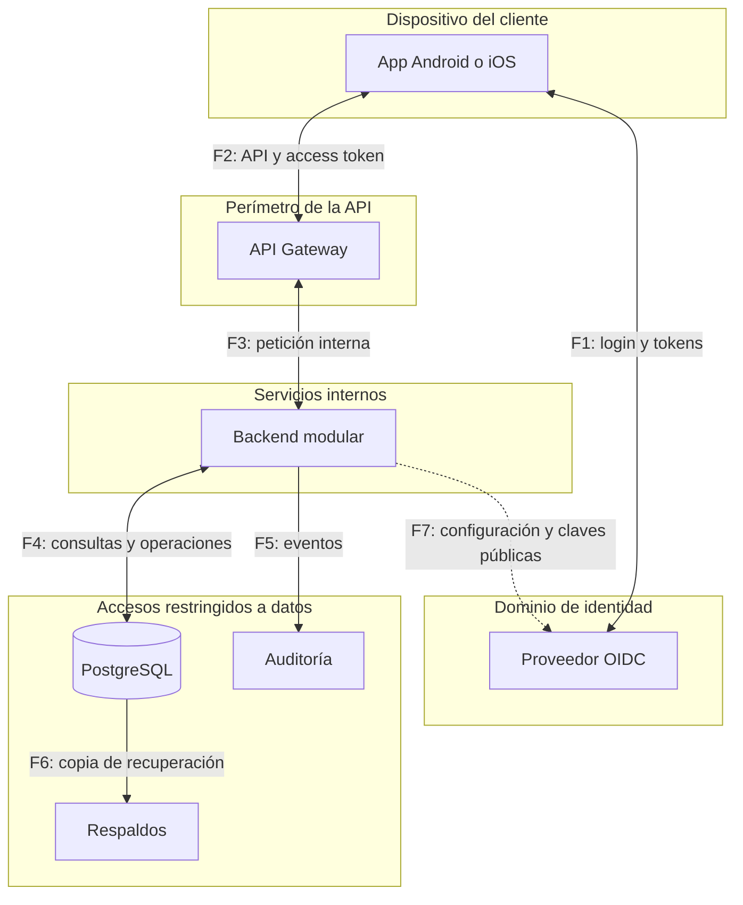

# 05 · Modelo de amenazas STRIDE

STRIDE ayuda a revisar el diseño preguntando qué puede hacer un atacante en cada flujo, qué control lo limita y cómo demostrar que ese control funciona. El resultado orienta código, configuración y pruebas.

**Estado:** análisis inicial, con 19 amenazas abiertas. Todos los controles y evidencias de este documento están pendientes de implementación o verificación. La prioridad inicial es alta, salvo TM-09, media; debe revisarse con el despliegue real.

## 1. Alcance y categorías

Se consideran app Android/iOS, IdP, gateway, backend, asistente con Gemini, PostgreSQL, auditoría, respaldos, HashiCorp Vault y PII Data Vault. El flujo contable supone registro local; los escenarios detallados de core, Kafka/outbox y atestación aún deben ampliarse.

Se protegen identidad y tokens, dinero e historial, datos personales, conversaciones, propuestas, secretos y disponibilidad. Los actores incluyen atacantes externos, usuarios que alteran solicitudes y dispositivos o cuentas técnicas comprometidos. La autorización se decide en el servidor.

| Categoría | Pregunta que guía la revisión |
|---|---|
| **S · Suplantación** | ¿Alguien puede hacerse pasar por otra identidad? |
| **T · Manipulación** | ¿Puede alterar datos o una operación? |
| **R · Repudio** | ¿Faltaría evidencia confiable para explicar lo ocurrido? |
| **I · Exposición de información** | ¿Puede leer datos que no le corresponden? |
| **D · Denegación de servicio** | ¿Puede agotar recursos o impedir operar? |
| **E · Elevación de privilegios** | ¿Puede obtener permisos que no tiene? |

Una amenaza puede pertenecer a varias categorías. Por ejemplo, cambiar el UUID de una cuenta pone a prueba tanto confidencialidad como autorización.

## 2. Flujos y límites de confianza

Los bloques representan dominios lógicos; su separación real depende de permisos e identidades. F1 incluye navegador y app; F7 obtiene configuración y claves públicas, sin consultar al IdP obligatoriamente en cada petición. Los flujos adicionales están en el [diagrama general](01-arquitectura.md#1-vista-general).

| Flujo | Cruce y control principal |
|---|---|
| **F1 / F7** | Cliente o backend ↔ IdP: emisor, redirecciones y claves confiables. |
| **F2** | App ↔ gateway: TLS, entradas no confiables y límites. |
| **F3** | Gateway ↔ backend: acceso restringido, canal verificado y autorización en backend. |
| **F4** | Backend ↔ PostgreSQL: identidad técnica, consultas parametrizadas y escritura controlada. |
| **F5 / F6** | Auditoría y respaldos: permisos separados, integridad y recuperación. |
| **F8** | Orquestador ↔ Gemini: contexto mínimo, salida no confiable y límites de uso. |
| **F9** | Orquestador → módulos: funciones permitidas y permisos del usuario validado. |
| **F10** | Backend → HashiCorp Vault: identidad del servicio y políticas por secreto/operación. |
| **F11** | Módulos → PII Data Vault: lectura mínima y permisos de descifrado específicos. |

Los tramos de red requieren TLS y verificación del extremo remoto; faltan concretar autenticación entre servicios y despliegue. Compartir una red o un proceso no garantiza aislamiento.

## 3. Escenarios, controles y pruebas

Cada fila conserva el identificador de seguimiento. Las pruebas se realizarán en un entorno autorizado con datos ficticios. **Una prueba prevista todavía no es evidencia de un control implementado.**

### Identidad y acceso

Detalle del flujo: [autenticación](03-autenticacion.md).

| ID / categoría | Escenario | Control propuesto | Evidencia esperada |
|---|---|---|---|
| **TM-01 · S** | Token falso, emisor/audiencia ajenos o claves arbitrarias. F2/F7. | Validar firma, algoritmo, emisor, audiencia, vigencia y perfil; JWKS confiable. | Rechazar tokens inválidos e ID tokens usados para la API, sin consultar URLs del atacante. |
| **TM-02 · S/T** | Interceptar el código o mezclar retornos de login. F1. | PKCE S256, `state`, `nonce`, redirecciones registradas y biblioteca OIDC. | En ambas plataformas, retorno incorrecto, verificador ajeno o `nonce` inválido no crean sesión; comprobar entrega a la app prevista. |
| **TM-03 · I/S** | Extraer y reutilizar tokens del dispositivo, copias, logs o tráfico. F1/F2/F5. | Keychain / cifrado con Keystore, access token en memoria, TLS y rotación. | Inspeccionar copias, logs y borrado; probar reutilización, renovación concurrente, logout con respuesta tardía y pérdida de claves sin reducir protección. |
| **TM-04 · I/E** | Consultar o debitar otra cuenta cambiando identificadores. F2–F4. | Identidad desde `(iss, sub)` y permisos funcionales y por cuenta. | Con dos usuarios, el cambio de UUID no entrega saldo ajeno ni permite debitarlo; ajena e inexistente responden igual. |

### Dinero e historial

Detalle de las garantías: [modelo relacional](02-modelo-relacional.md).

| ID / categoría | Escenario | Control propuesto | Evidencia esperada |
|---|---|---|---|
| **TM-05 · T/E** | Importe, moneda u origen inválidos; reversión no autorizada. F2–F4. | Validar datos exactos, límites y autorización de transferencia/reversión. | Rechazar esos casos aunque las entradas propuestas sumen cero. |
| **TM-06 · T** | Duplicar efectos o gastar simultáneamente el mismo saldo. F2–F4. | Clave única y hash, atomicidad, bloqueos ordenados y nueva lectura del saldo. | Reintentos simultáneos, respuesta perdida tras commit, fallo entre entradas y operaciones distintas no duplican efectos ni exceden fondos. |
| **TM-07 · T/E** | Escribir fuera del circuito o modificar asientos confirmados. F4. | Rol sin privilegios administrativos, contabilización controlada e historial protegido. | Rechazar INSERT fuera del circuito y UPDATE/DELETE de confirmados; revisar accesos privilegiados. |
| **TM-08 · R/T** | Borrar evidencias o registrar como confirmado un rollback. F4/F5. | Auditoría vinculada a actor y operación; confirmaciones consistentes con commit e intentos fuera del rollback financiero. | Reconstruir intento y resultado; un rollback no aparece confirmado y la aplicación no borra evidencias. |

### Plataforma y operación

| ID / categoría | Escenario | Control propuesto | Evidencia esperada |
|---|---|---|---|
| **TM-09 · I** | Exponer SQL, trazas o estructura interna en errores. F2/F3. | Respuesta genérica, `request_id`, `no-store` y diagnóstico restringido. | Forzar errores sin revelar detalles internos ni datos de clientes. |
| **TM-10 · D** | Saturar API, saldo, búsquedas de claves o bloqueos. F2–F4/F7. | Límites antes de autenticar y por usuario, caché JWKS, tamaño/coste y esperas acotados. | Carga y dependencias lentas no agotan recursos ni disparan consultas de claves o renovaciones ilimitadas. |
| **TM-11 · S/E** | Evadir el gateway o falsificar encabezados internos. F3. | Acceso directo restringido, canal verificado y validación/autorización en backend. | Origen no permitido o encabezado falso no dan acceso; el backend exige token válido. |
| **TM-12 · T/I/E** | Convertir una entrada en parte de una consulta SQL. F2–F4. | Consultas parametrizadas, tipos validados y permisos mínimos. | Revisar consultas y comprobar que la entrada se rechaza o trata como dato, sin cambiar SQL. |
| **TM-13 · T/D** | Perder el ledger y descubrir respaldos inutilizables. F4/F6. | Copias con acceso separado, retención, integridad y restauración probada. | Restaurar en aislamiento y reconstruir saldo, apertura y reversión hasta el corte acordado; medir pérdida y tiempo de recuperación. |

### Asistente y secretos

Detalle del intercambio: [contrato del asistente](04-contratos-api.md#5-asistente).

| ID / categoría | Escenario | Control propuesto | Evidencia esperada |
|---|---|---|---|
| **TM-14 · S/I/E** | Acceder a conversación, saldo o propuesta ajenos. F2/F3/F9. | Propietario desde usuario autenticado, autorización por acceso y turnos serializados. | Intercambiar identificadores no entrega datos ajenos; turnos concurrentes no mezclan respuestas. |
| **TM-15 · T/E** | Instrucciones del chat o contenido recuperado inducen funciones indebidas. F8/F9. | Lista permitida, esquemas estrictos y autorización fuera del modelo; sin SQL, URLs arbitrarias ni ejecución financiera. | Instrucciones directas e indirectas no producen efectos fuera de permisos, aunque Gemini proponga la llamada. |
| **TM-16 · I** | Enviar a Gemini o registrar secretos y datos innecesarios. F5/F8/F10/F11. | Campos de contexto admitidos, minimización y logs/historial restringidos. | Inspeccionar mensajes y registros sin tokens ni secretos; un fallo de consulta no se presenta como saldo válido. |
| **TM-17 · D** | Bucles de funciones, mensajes excesivos o demoras consumen recursos. F2/F8/F9. | Limitar mensajes, historial, tokens, funciones, concurrencia, tiempo total y reintentos; separar capacidad del chat. | Simular demoras y bucles: error controlado y capacidad conservada para operaciones directas. |
| **TM-18 · T/E/R** | Ejecutar propuesta alterada, vencida, ajena o duplicada; eludir riesgo. F2–F4/F9. | Propuesta canónica, confirmación separada verificada, vínculo único y controles financieros. | Preparar no mueve dinero; propuestas inválidas se rechazan y confirmaciones concurrentes con claves distintas generan máximo una operación. |
| **TM-19 · I/E** | Identidad técnica obtiene secretos o descifra PII fuera de su función. F10/F11. | Políticas de Vault por servicio/secreto/operación; separar administración y uso de claves de lectura de PII. | El adaptador de IA obtiene solo su credencial; no administra claves ni descifra PII. Revisar privilegios efectivos, incluso dentro de un proceso compartido. |

## 4. Riesgos y definiciones pendientes

- **Sesión comprometida:** un bearer token robado puede usarse mientras siga válido. Faltan duración, revocación, MFA, step-up y la solución mantenida de almacenamiento Android.
- **Acceso privilegiado:** proteger el rol de la aplicación no cubre a un administrador comprometido. Deben concretarse separación de permisos, protección de evidencia y restauración.
- **Intención del usuario:** la identidad técnica no demuestra consentimiento. Falta cerrar la confirmación vinculada a los datos y el tratamiento de reversiones.
- **Gemini y Vault:** acordar datos admitidos, retención, cuotas, límites, identidades y recuperación. El prompt necesita controles del servidor; cifrar tampoco evita el abuso de un permiso legítimo de descifrado.
- **Flujos por ampliar:** publicación y consumidores outbox/Kafka, retención, pinning/atestación y conciliación con el core. No se consideran cubiertos por nombrarlos en el diagrama.

## 5. Seguimiento

Al implementar cada flujo, vincular su ID de amenaza con el cambio, responsable y evidencia: fecha, prueba, resultado y riesgo restante. El cierre o aceptación requiere una decisión explícita del equipo.

Actualizar el análisis al elegir proveedores, incorporar endpoints o roles, cambiar almacenamiento/despliegue o integrar el core. Las pruebas de este documento centralizan las comprobaciones de seguridad de las demás secciones.

## Para profundizar

- OWASP: [proceso de threat modeling](https://cheatsheetseries.owasp.org/cheatsheets/Threat_Modeling_Cheat_Sheet.html). Microsoft: [categorías STRIDE](https://learn.microsoft.com/en-us/azure/security/develop/threat-modeling-tool-threats).
- OWASP: [autorización](https://cheatsheetseries.owasp.org/cheatsheets/Authorization_Cheat_Sheet.html), [SQL injection](https://cheatsheetseries.owasp.org/cheatsheets/SQL_Injection_Prevention_Cheat_Sheet.html) y [auditoría](https://cheatsheetseries.owasp.org/cheatsheets/Logging_Cheat_Sheet.html).
- OWASP: [prompt injection](https://cheatsheetseries.owasp.org/cheatsheets/LLM_Prompt_Injection_Prevention_Cheat_Sheet.html) y [privilegios excesivos del asistente](https://genai.owasp.org/llmrisk/llm062025-excessive-agency/).
- [HashiCorp Vault: políticas](https://developer.hashicorp.com/vault/docs/concepts/policies).
