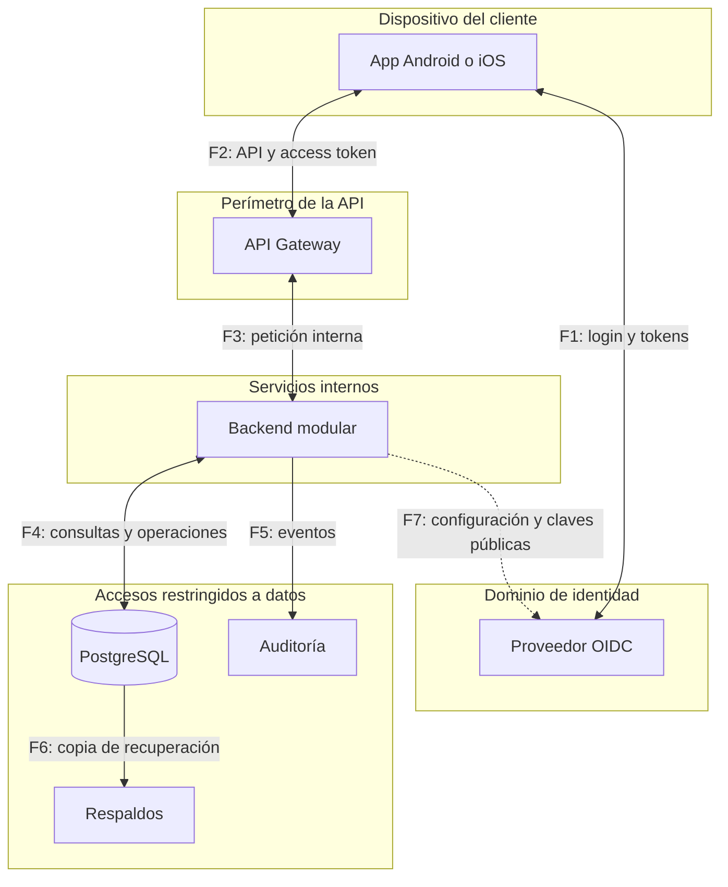

# 05 · Modelo de amenazas STRIDE

Presento el análisis inicial de amenazas de la aplicación bancaria. Cada escenario se vincula con los flujos afectados, los controles propuestos y la evidencia necesaria para verificarlos.

**Estado:** análisis inicial. Los controles están propuestos y su implementación y verificación están pendientes. Las 13 amenazas identificadas permanecen abiertas.

## 1. Alcance y supuestos

Incluye app Android e iOS, proveedor OIDC, API Gateway, backend modular, PostgreSQL, auditoría y recuperación. Cubre login, tokens, consulta de saldo y el diseño de transferencias internas y reversiones. El contrato de transferencias todavía no está definido.

El alcance de ambas plataformas está confirmado; el framework móvil y la solución de almacenamiento de Android siguen pendientes. TM-02 y TM-03 requieren revisar por plataforma el retorno del login, persistencia, copias, acceso a claves y cierre de sesión. Este análisis común todavía necesita concretarse con las bibliotecas y configuraciones elegidas.

El supuesto actual es que PostgreSQL registra el dinero de forma autoritativa. Incorporar un core externo requiere ampliar los flujos y analizar confirmaciones, duplicados y conciliación entre sistemas.

**Activos:** identidad y tokens; cuentas y saldos; integridad del ledger; evidencias de operaciones; disponibilidad y copias recuperables.

**Actores considerados:** atacante externo, usuario autenticado que modifica solicitudes, persona con acceso al dispositivo y proceso o cuenta operativa comprometida. La app puede ser manipulada; las decisiones de autorización se toman en el servidor.

## 2. Flujos y fronteras de confianza

F1 agrupa el login por navegador del sistema y los intercambios de tokens de la app; su secuencia está en autenticación. La línea discontinua F7 es una dependencia para validar tokens, no una consulta obligatoria por petición.

Los bloques muestran dominios lógicos de confianza, no una red ya desplegada. Auditoría y respaldos son capacidades a concretar; su ubicación y sus permisos deben impedir que una misma credencial comprometa todas las copias de la evidencia.

| Cruce | Controles a verificar |
|---|---|
| F1/F7: cliente o backend → identidad | Emisor y URL configurados, redirección registrada, claves confiables y validaciones OIDC/JWT. |
| F2: cliente → gateway | Canal protegido; límites de entrada; contenido tratado como no confiable. |
| F3: gateway → backend | Origen permitido, protección del canal y validación de identidad y permisos en el backend. Un encabezado no sustituye al token validado. |
| F4: backend → base | Identidad del servicio, permisos mínimos, consultas parametrizadas y escrituras financieras controladas. |
| F5/F6: eventos y recuperación | Accesos diferenciados, integridad, retención y restauración verificable. |

**Requisito propuesto:** proteger los tramos de red con TLS y verificar certificados e identidades del extremo remoto; concretar la autenticación entre servicios al elegir el despliegue. La red interna no elimina estas comprobaciones. [8]

## 3. Amenazas priorizadas

STRIDE clasifica amenazas: **S** suplantación, **T** alteración, **R** repudio, **I** exposición de información, **D** denegación de servicio y **E** elevación de privilegios. Una amenaza puede pertenecer a más de una categoría. [1][2]

La prioridad es una estimación inicial según impacto y exposición: **alta** para identidad, dinero, datos privados o continuidad del servicio; **media** para exposición técnica sin secretos ni datos de clientes. Debe revisarse con el entorno real y no representa una medición de probabilidad.

| ID | STRIDE | Escenario y flujo afectado | Prioridad |
|---|---|---|---|
| TM-01 | S | Presentar un token falso, de otro emisor o destinado a otra aplicación; inducir confianza en claves arbitrarias. F2/F7. | Alta |
| TM-02 | S/T | Interceptar un código o mezclar respuestas de distintos intentos de login para iniciar otra sesión. F1. | Alta |
| TM-03 | I/S | Extraer tokens del dispositivo, sus copias, logs o tráfico y reutilizarlos. F1/F2/F5 y persistencia local. | Alta |
| TM-04 | I/E | Cambiar `account_id` o atribuirse otro usuario para consultar o debitar una cuenta ajena. F2–F4. | Alta |
| TM-05 | T/E | Enviar importes, monedas u orígenes inválidos, o ejecutar una reversión sin autorización. F2–F4. | Alta |
| TM-06 | T | Repetir o lanzar operaciones en paralelo para duplicar un efecto o gastar el mismo saldo varias veces. F2–F4. | Alta |
| TM-07 | T/E | Usar permisos excesivos para insertar movimientos fuera del circuito o modificar el historial confirmado. F4. | Alta |
| TM-08 | R/T | Borrar o falsificar evidencias, o registrar como confirmada una operación que terminó en rollback. F4/F5. | Alta |
| TM-09 | I | Provocar errores que revelen consultas SQL, trazas o estructura interna. F2/F3. | Media |
| TM-10 | D | Saturar la API, las consultas de saldo, la validación de claves o las esperas por bloqueos. F2–F4/F7. | Alta |
| TM-11 | S/E | Acceder directamente al backend o falsificar encabezados internos para eludir controles del gateway. F3. | Alta |
| TM-12 | T/I/E | Conseguir que un dato recibido se interprete como parte de una consulta SQL. F2–F4. | Alta |
| TM-13 | T/D | Tras una alteración o pérdida de datos, descubrir que los respaldos también fueron afectados o no permiten recuperar el ledger. F4/F6. | Alta |

## 4. Controles y evidencia esperada

Las pruebas siguientes se ejecutarán en un entorno autorizado, con datos ficticios. **Estado común de las 13 amenazas: abierto; control propuesto y evidencia pendiente.**

| ID | Control propuesto | Evidencia esperada |
|---|---|---|
| TM-01 | Validar firma, algoritmo permitido, emisor, audiencia, vigencia y perfil; obtener claves solo de configuración confiable. | Rechazar tokens falsos, vencidos, de otra audiencia o ID tokens usados como acceso; no consultar URL indicadas por un atacante. |
| TM-02 | Authorization Code con PKCE S256, `state`, `nonce` y redirecciones registradas para cada plataforma, mediante biblioteca OIDC. | En Android e iOS, un retorno con `state` incorrecto, un verificador ajeno o un `nonce` inválido no crea sesión; verificar también la entrega del retorno a la app prevista. |
| TM-03 | Keychain en iOS; cifrado del refresh token con claves protegidas por Keystore como criterio propuesto para Android, con integración pendiente. Access token en memoria, TLS, secretos fuera de logs y rotación. Acordar duración, revocación y MFA. | Revisar persistencia, copias, logs y borrado de credenciales en ambas plataformas; verificar rotación/reutilización, almacenamiento inaccesible y pérdida de claves sin reducir la protección. |
| TM-04 | Identidad desde `(iss, sub)` validado; permiso funcional y autorización sobre cada cuenta. | Dos usuarios y cuentas distintas: cambiar el identificador no devuelve saldo ajeno ni permite debitarlo; consulta ajena e inexistente responden igual. |
| TM-05 | Validar cuenta, moneda, importe exacto y límites; comprobar autorización de transferencia y reversión. | Rechazar importe inválido, moneda incoherente y reversión no autorizada. Un asiento balanceado por sí solo no satisface estas pruebas. |
| TM-06 | Clave única por usuario, hash del contenido, atomicidad y bloqueo ordenado con nueva lectura del saldo. | Reintentos, fallo entre entradas y operaciones concurrentes no duplican efectos ni exceden los fondos. |
| TM-07 | Rol de ejecución sin privilegios administrativos ni escritura financiera libre; circuito controlado e historial confirmado protegido. | Con ese rol, rechazar INSERT fuera del circuito y UPDATE/DELETE sobre movimientos confirmados. Revisar también accesos privilegiados. |
| TM-08 | Auditoría vinculada a identidad, solicitud y operación; confirmaciones consistentes con el commit; intentos registrados fuera del rollback financiero. [6] | Reconstruir intento, resultado y movimientos; un rollback no queda como confirmación. La aplicación no puede borrar evidencias. |
| TM-09 | Respuestas genéricas con `request_id`, `no-store` y diagnóstico detallado solo en registros restringidos. | Forzar errores controlados y revisar que la respuesta no revele SQL, trazas ni información de otras cuentas. |
| TM-10 | Límites antes de autenticar y por usuario validado; tamaño y coste acotados, timeouts, espera de bloqueos y reintentos limitados; caché de claves. [7] | Carga controlada y dependencias lentas: aplicar límites sin agotar recursos ni provocar renovaciones o consultas de claves ilimitadas. |
| TM-11 | Restringir acceso directo; verificar el canal interno; mantener validación y autorización en el backend e ignorar identidades aportadas por encabezados no confiables. | Rechazar acceso desde orígenes no permitidos y encabezados de usuario falsos; una petición sin token válido no obtiene acceso. |
| TM-12 | Consultas parametrizadas, validación de tipos y permisos mínimos. No concatenar entradas en SQL. [4][5] | Revisar las consultas y comprobar que valores con sintaxis SQL se rechazan o se tratan como datos, sin cambiar la consulta. |
| TM-13 | Respaldos protegidos con accesos separados, política de retención, verificación de integridad y pruebas de restauración. | Restaurar en un entorno aislado y reconstruir saldos hasta el corte acordado; comprobar pérdida de datos y tiempo de recuperación. |

La autorización por recurso debe comprobarse en cada operación protegida. [3] La partida doble aporta coherencia contable; necesita autorización, integridad y control de quién puede escribir para proteger el dinero.

## 5. Responsabilidades y vínculos

Las responsabilidades se agrupan por área. Queda pendiente asignar responsables y revisores; esta distribución no define servicios adicionales.

| Área | Amenazas principales | Documento relacionado |
|---|---|---|
| Móvil e identidad | TM-01–TM-03 | [Autenticación](03-autenticacion.md), secciones 1–4. |
| Backend y datos | TM-04–TM-08, TM-12 | Modelo lógico, secciones 2–5; contratos de saldo y futuros contratos de transferencias. |
| Plataforma y operación | TM-07–TM-11, TM-13 | Controles de acceso, transporte, auditoría, límites y recuperación de este análisis. |
| Backend y móvil | TM-04, TM-09, TM-10 | [Contratos de API](04-contratos-api.md), secciones 4–5. |

## 6. Decisiones abiertas y riesgo residual

- **Protección local en Android:** confirmar una implementación mantenida, versiones soportadas y políticas de claves, copias y recuperación. La referencia inicial a `EncryptedSharedPreferences` está deprecada; el reemplazo y su verificación siguen pendientes. Los criterios se detallan en [autenticación](03-autenticacion.md), sección 4.
- **Sesión comprometida:** un bearer token válido robado puede utilizarse mientras siga vigente. Queda pendiente definir duración, revocación, MFA y reautenticación para operaciones sensibles; Keychain y PKCE no eliminan por sí solos ese riesgo.
- **Acceso privilegiado:** proteger las escrituras de la aplicación no protege automáticamente frente a un administrador comprometido. Faltan separación de permisos, controles sobre la operación y protección independiente de evidencias y respaldos.
- **Consentimiento de una operación:** una identidad técnica válida no demuestra por sí sola la intención del titular. Queda pendiente definir la política de confirmación de transferencias y reversiones.
- **Configuración real:** faltan proveedor, despliegue, límites, timeouts, esquema de auditoría y objetivos de recuperación. No se asigna riesgo residual como aceptado mientras estas decisiones y sus verificaciones sigan abiertas.

## 7. Mantenimiento del análisis

Antes de implementar cada flujo deben revisarse sus amenazas y definirse los controles pendientes. Cada ID debe vincularse al cambio que implementa el control y a su evidencia de prueba. El registro debe incluir responsable, fecha, resultado y riesgo residual. El cierre o la aceptación de un riesgo requiere una decisión explícita del equipo.

El análisis debe actualizarse al elegir stack y proveedor, incorporar endpoints o roles, cambiar almacenamiento o despliegue, integrar un core externo o descubrir un fallo. [1]

## Referencias

1. [OWASP: proceso de threat modeling](https://cheatsheetseries.owasp.org/cheatsheets/Threat_Modeling_Cheat_Sheet.html).
2. [Microsoft: categorías STRIDE](https://learn.microsoft.com/en-us/azure/security/develop/threat-modeling-tool-threats).
3. [OWASP: autorización](https://cheatsheetseries.owasp.org/cheatsheets/Authorization_Cheat_Sheet.html).
4. [OWASP: seguridad de bases de datos](https://cheatsheetseries.owasp.org/cheatsheets/Database_Security_Cheat_Sheet.html).
5. [OWASP: prevención de inyección SQL](https://cheatsheetseries.owasp.org/cheatsheets/SQL_Injection_Prevention_Cheat_Sheet.html).
6. [OWASP: registro de eventos](https://cheatsheetseries.owasp.org/cheatsheets/Logging_Cheat_Sheet.html).
7. [OWASP: denegación de servicio](https://cheatsheetseries.owasp.org/cheatsheets/Denial_of_Service_Cheat_Sheet.html).
8. [OWASP: seguridad del transporte](https://cheatsheetseries.owasp.org/cheatsheets/Transport_Layer_Security_Cheat_Sheet.html).
